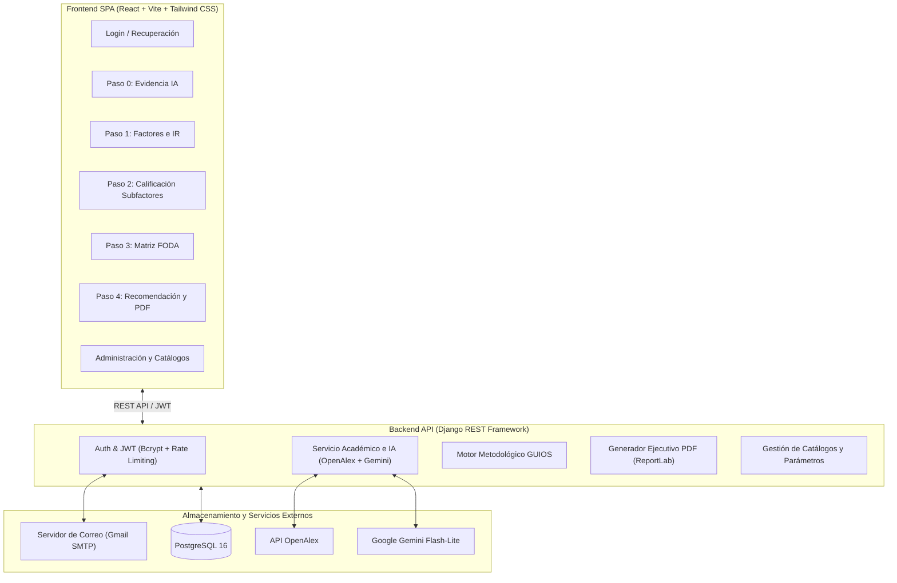
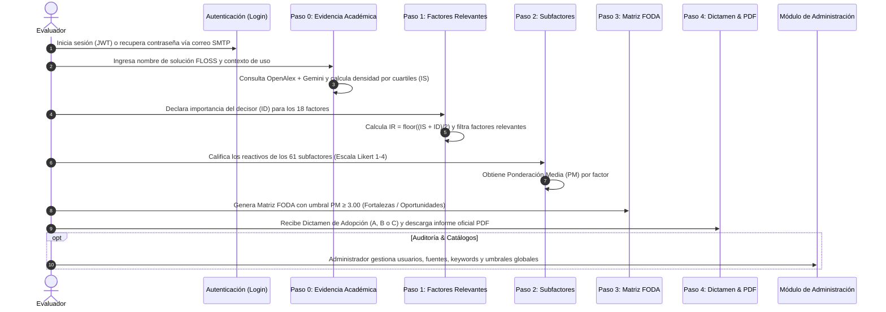

# GUIOS+ — Guía Integral del Flujo Metodológico de Inicio a Fin

**GUIOS+** (*Goal-driven, User-centric, Interoperable, Open-source Selection Platform*) es una plataforma de apoyo a la toma de decisiones para la evaluación, selección y adopción de software libre (**FLOSS**), sustentada en la formulación matemática de la Tesis Doctoral de la metodología GUIOS.

---

## 1. Arquitectura General del Sistema

El sistema opera bajo una arquitectura desacoplada y orientada a servicios:

---

## 2. Flujo Completo de Principio a Fin (Paso a Paso)

El ciclo de vida de una evaluación comprende desde el acceso del usuario hasta el dictamen formal de adopción:

---

### Módulo A: Seguridad, Autenticación y Recuperación de Contraseña

1. **Inicio de Sesión (`/login`):**
   - Autenticación mediante correo electrónico y contraseña protegida con hash Bcrypt.
   - Control de fuerza bruta: bloqueo temporal de seguridad tras **5 intentos fallidos consecutivos**.
2. **Recuperación de Contraseña:**
   - Si el usuario olvida su credencial, solicita el restablecimiento institucional.
   - El sistema genera un identificador seguro (`uid`) en base64 y un token firmado con HMAC (`default_token_generator`).
   - Se despacha un correo electrónico multipart (versión texto plano y plantilla HTML con identidad GUIOS+) a través de **Google SMTP**.
   - El token cuenta con una vigencia de **1 hora** y queda **invalidado automáticamente** tras el primer uso.

---

### Paso 0: Evidencia Bibliográfica e Importancia Sugerida ($IS$)

1. **Configuración de la Solución:**
   - El evaluador especifica el nombre del software (ej. *PostgreSQL*, *Nextcloud*, *LibreOffice*), el contexto de uso y las fuentes bibliográficas activas.
2. **Motor de Búsqueda Académica e Inferencia:**
   - Expansión de sinónimos mediante **Google Gemini** (`gemini-flash-lite-latest`).
   - Consulta paralela a **OpenAlex** respetando la ventana temporal configurada (por defecto 2016-2026).
   - En caso de saturación o límite de peticiones (HTTP 429), se activa automáticamente el *benchmark* empírico de la Revisión Sistemática de Literatura (RSL) de la tesis doctoral (54 estudios indexados en Scopus/WoS).
3. **Estandarización por Cuartiles:**
   - Se computa la métrica continua de densidad:
     $$\text{métrica}_i = \text{citas}_i + 0.25 \times \text{documentos}_i$$
   - Se normalizan las densidades en el intervalo $[0, 1]$ y se asigna el nivel discreto de la escala Likert ($IS \in \{1, 2, 3, 4\}$) según cuartiles:
     - $Q_1$ (0 a 25%): Nivel 1 (Irrelevante)
     - $Q_2$ (26 a 50%): Nivel 2 (Opcional)
     - $Q_3$ (51 a 75%): Nivel 3 (Importante)
     - $Q_4$ (76 a 100%): Nivel 4 (Fundamental)

---

### Paso 1: Factores Relevantes e Importancia Relativa ($IR$)

1. **Entrada del Decisor ($ID$):**
   - El evaluador califica los 18 factores de la metodología asignando su Importancia Declarada ($ID \in \{1, 2, 3, 4\}$).
2. **Ecuación Fundamental de la Tesis:**
   - Se calcula la Importancia Relativa ($IR$) mediante la regla de redondeo hacia abajo:
     $$IR = \left\lfloor \frac{IS + ID}{2} \right\rfloor$$
3. **Criterio de Relevancia:**
   - **$IR = 1$:** Factor *Irrelevante* (se descarta para evaluación técnica detallada).
   - **$IR > 1$ ($2, 3, 4$):** Factor *Relevante* (*Opcional*, *Importante* o *Fundamental*).
4. **Validación de Alcance:**
   - Si el factor tiene alcance nativo "Ambos" (como *Soporte*) y resulta Relevante, el evaluador debe especificar si se medirá como **Interno** u **Externo**.

---

### Paso 2: Evaluación Técnica de Subfactores

1. **Despliegue Dinámico de Reactivos:**
   - Se cargan únicamente los subfactores asociados a los factores que resultaron **relevantes** en el Paso 1 (de entre los 61 subfactores del catálogo).
2. **Calificación:**
   - El evaluador asigna una nota del 1 al 4 a cada reactivo, con justificación u observación obligatoria.
3. **Ponderación Media ($PM$):**
   - Para cada factor $k$, se calcula la media aritmética de sus subfactores calificados:
     $$PM_k = \frac{1}{N_k} \sum_{j=1}^{N_k} C_{kj}$$

---

### Paso 3: Clasificación en la Matriz FODA

Cada factor relevante se clasifica en uno de los 4 cuadrantes FODA según su alcance y su Ponderación Media ($PM$):

| Alcance | $PM \ge 3.00$ (Favorable) | $PM < 3.00$ (Desfavorable) |
| :---: | :---: | :---: |
| **Interno** | **Fortaleza (F)** | **Debilidad (D)** |
| **Externo** | **Oportunidad (O)** | **Amenaza (A)** |

- **Factores Críticos:** Una Debilidad o Amenaza cuyo $IR \in \{3, 4\}$ (*Importante* o *Fundamental*) se cataloga como **Crítico**.

---

### Paso 4: Dictamen de Adopción y Generación de PDF

1. **Reglas Metodológicas de Decisión:**
   - **Recomendación A (Adoptar sin observaciones):**  
     Todos los factores relevantes están clasificados como Fortalezas u Oportunidades (sin Debilidades ni Amenazas).
   - **Recomendación B (Adoptar con observaciones en factores opcionales):**  
     Existen Debilidades o Amenazas, pero únicamente en factores opcionales ($IR = 2$). Ningún factor crítico ($IR \ge 3$) está comprometido.
   - **Recomendación C (Requiere recursos antes de adoptar):**  
     Existe al menos un factor crítico ($IR \in \{3, 4\}$) clasificado como Debilidad o Amenaza.
2. **Índice de Viabilidad y Nivel de Confianza:**
   - $\text{Viabilidad (\%)} = \left(\frac{\text{Factores Favorables}}{\text{Total Factores Relevantes}}\right) \times 100$
   - $\text{Nivel de Confianza} \in \{\text{Alto}, \text{Medio}, \text{Bajo}\}$ determinado por la tasa de certeza en las respuestas.
3. **Exportación Oficial (PDF):**
   - Generación instantánea ($< 2$ s) de un informe ejecutivo con portada, dictamen formal, desglose FODA, análisis dimensional y anexo técnico con los 61 reactivos.

---

### Módulo de Administración y Auditoría

- **Gestión de Usuarios (HU-02):** Alta, edición, activación/inactivación y cambio de roles, con protección contra la eliminación del último administrador activo.
- **Catálogo GUIOS (HU-03):** Gestión de dimensiones, factores, subfactores y palabras clave para la búsqueda bibliográfica.
- **Parámetros Globales de Cálculo:** Configuración de ventana temporal (año inicio y fin), idiomas soportados y modo de inferencia.
- **Auditoría (RNF-03):** Registro inmutable en `log_auditoria` con usuario, timestamp, acción y detalle para trazabilidad integral.

---

## 3. Resumen de Fórmulas Matemáticas de la Metodología

$$\begin{aligned}
\text{Densidad Bibliográfica:} \quad & \text{métrica}_i = \text{citas}_i + 0.25 \times \text{documentos}_i \\
\text{Importancia Sugerida (IA):} \quad & IS_i \in \{1, 2, 3, 4\} \quad \text{(según cuartil de densidad)} \\
\text{Importancia Relativa:} \quad & IR_i = \left\lfloor \frac{IS_i + ID_i}{2} \right\rfloor \\
\text{Ponderación Media Factor:} \quad & PM_k = \frac{1}{N_k} \sum_{j=1}^{N_k} C_{kj} \\
\text{Umbral FODA Favorable:} \quad & PM_k \ge 3.00 \\
\text{Índice de Viabilidad:} \quad & V = \left(\frac{N_{\text{favorables}}}{N_{\text{relevantes}}}\right) \times 100
\end{aligned}$$

