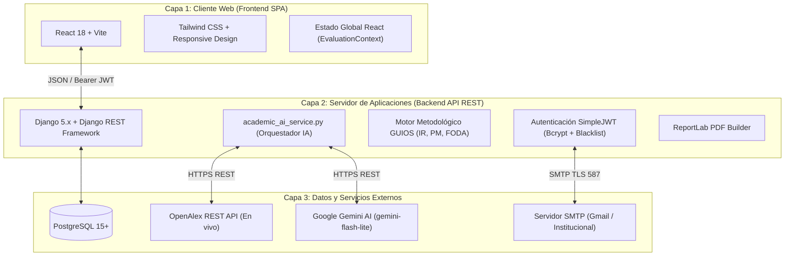
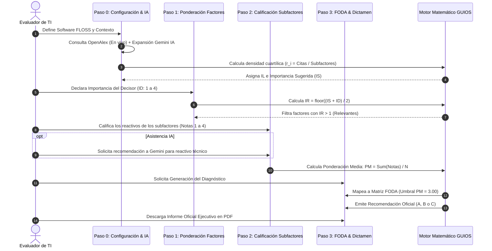

# Manual de Usuario Exhaustivo — GUIOS+ (GUIOSPRO FLOSS Web)
### Plataforma de Apoyo a las Decisiones para la Adopción Científica y Automatizada de Software Libre y Fuentes Abiertas

---

## 📋 Información y Control del Documento

* **Nombre del Sistema:** GUIOSPRO FLOSS Web (Marca comercial: **GUIOS+**)
* **Versión del Software:** 2.0 (Edición Web Empresarial Multi-inquilino)
* **Marco Metodológico:** Guía GUIOS — Tesis Doctoral *PhD. Víctor Hugo Rea Sánchez* (Universidad de Sevilla, 2022)
* **Fecha de Actualización:** Noviembre de 2026
* **Audiencia Objetivo:** Evaluadores de Tecnologías de Información (TI), Directores de Sistemas (CIO/CTO), Comités de Adopción de Software, Auditores Informáticos y Administradores de Plataforma.

---

## Índice General

1. [Visión General y Metodología Científica](#1-visión-general-y-metodología-científica)
2. [Arquitectura del Sistema y Requisitos Técnicos](#2-arquitectura-del-sistema-y-requisitos-técnicos)
3. [Matriz de Roles y Permisos (RBAC)](#3-matriz-de-roles-y-permisos-rbac)
4. [Módulo 1: Acceso, Autenticación y Gestión de Cuentas](#4-módulo-1-acceso-autenticación-y-gestión-de-cuentas)
   - 4.1. [Pantalla de Inicio de Sesión (`/login`)](#41-pantalla-de-inicio-de-sesión-login)
   - 4.2. [Registro de Nuevos Evaluadores (`/register` o `/registro`)](#42-registro-de-nuevos-evaluadores-register-o-registro)
   - 4.3. [Recuperación Segura de Contraseña Vía SMTP](#43-recuperación-segura-de-contraseña-vía-smtp)
   - 4.4. [Restablecimiento de Contraseña (`/reset-password`)](#44-restablecimiento-de-contraseña-reset-password)
   - 4.5. [Cierre de Sesión y Revocación de Tokens JWT](#45-cierre-de-sesión-y-revocación-de-tokens-jwt)
5. [Módulo 2: Estructura de la Interfaz y Layout General](#5-módulo-2-estructura-de-la-interfaz-y-layout-general)
   - 5.1. [Barra Lateral de Navegación (Sidebar)](#51-barra-lateral-de-navegación-sidebar)
   - 5.2. [Encabezado Superior y Selector de Evaluación Activa](#52-encabezado-superior-y-selector-de-evaluación-activa)
6. [Módulo 3: Panel de Control Principal (Dashboard)](#6-módulo-3-panel-de-control-principal-dashboard)
   - 6.1. [Tarjetas de Indicadores Clave (KPIs)](#61-tarjetas-de-indicadores-clave-kpis)
   - 6.2. [Creación de una "Nueva Evaluación" en Blanco](#62-creación-de-una-nueva-evaluación-en-blanco)
   - 6.3. [Búsqueda, Filtros y Acciones sobre Evaluaciones](#63-búsqueda-filtros-y-acciones-sobre-evaluaciones)
7. [Módulo 4: El Flujo Metodológico de Evaluación (Paso a Paso)](#7-el-flujo-metodológico-de-evaluación-paso-a-paso)
   - 7.1. [Paso 0: Configuración Automática y Evidencia Bibliográfica con IA (`/configuracion`)](#71-paso-0-configuración-automática-y-evidencia-bibliográfica-con-ia-configuracion)
   - 7.2. [Paso 1: Ponderación de Factores Relevantes (`/factores`)](#72-paso-1-ponderación-de-factores-relevantes-factores)
   - 7.3. [Paso 2: Evaluación Práctica de Subfactores (`/subfactores`)](#73-paso-2-evaluación-práctica-de-subfactores-subfactores)
   - 7.4. [Paso 3: Matriz FODA y Recomendación Oficial (`/resultado`)](#74-paso-3-matriz-foda-y-recomendación-oficial-resultado)
8. [Módulo 5: Centro de Evidencia Científica Detallada (`/evidencia`)](#8-módulo-5-centro-de-evidencia-científica-detallada-evidencia)
   - 8.1. [Métricas Globales de Investigación](#81-métricas-globales-de-investigación)
   - 8.2. [Inspección de Citas y Modal de Artículos por Factor](#82-inspección-de-citas-y-modal-de-artículos-por-factor)
   - 8.3. [Sincronización Directa de Evidencia](#83-sincronización-directa-de-evidencia)
9. [Módulo 6: Generación y Descarga del Informe Oficial en PDF](#9-módulo-6-generación-y-descarga-del-informe-oficial-en-pdf)
   - 9.1. [Estructura del Informe Generado](#91-estructura-del-informe-generado)
   - 9.2. [Uso Institucional y Firmas de Responsabilidad](#92-uso-institucional-y-firmas-de-responsabilidad)
10. [Módulo 7: Panel de Administración Avanzada (Solo Administradores - `/administracion`)](#10-módulo-7-panel-de-administración-avanzada-solo-administradores---administracion)
    - 10.1. [Pestaña 1: Gestión Integral de Usuarios y Permisos](#101-pestaña-1-gestión-integral-de-usuarios-y-permisos)
    - 10.2. [Pestaña 2: Parámetros Globales y Umbrales Matemáticos](#102-pestaña-2-parámetros-globales-y-umbrales-matemáticos)
    - 10.3. [Pestaña 3: Catálogo Oficial y Descriptores de Búsqueda](#103-pestaña-3-catálogo-oficial-y-descriptores-de-búsqueda)
    - 10.4. [Pestaña 4: Diagnóstico de Conectividad y APIs Externas](#104-pestaña-4-diagnóstico-de-conectividad-y-apis-externas)
    - 10.5. [Pestaña 5: Bitácora Inmutable de Auditoría de Seguridad](#105-pestaña-5-bitácora-inmutable-de-auditoría-de-seguridad)
11. [Guía de Fórmulas Matemáticas e Indicadores GUIOS](#11-guía-de-fórmulas-matemáticas-e-indicadores-guios)
12. [Preguntas Frecuentes, Errores Comunes y Soluciones (FAQ)](#12-preguntas-frecuentes-errores-comunes-y-soluciones-faq)

---

## 1. Visión General y Metodología Científica

La adopción de software libre y de fuentes abiertas (**FLOSS**, *Free/Libre Open Source Software*) aporta soberanía tecnológica, independencia frente a monopolios de proveedores (*anti-vendor lock-in*), seguridad auditable y ahorro sustancial de recursos públicos. No obstante, cuando las instituciones migran sin una metodología estandarizada, enfrentan graves problemas: incompatibilidad de formatos de datos, resistencia cultural de los usuarios, costos ocultos de soporte y deserciones de proyectos.

**GUIOS+** materializa la solución formulada en la tesis doctoral del **PhD. Víctor Hugo Rea Sánchez** (Universidad de Sevilla, 2022). Esta metodología fue construida sobre:
1. Una **Revisión Sistemática de la Literatura (RSL)** de 14 años (2008–2019) evaluando 4.429 artículos iniciales hasta seleccionar **54 estudios primarios** de alta calidad científica.
2. Un estudio de campo empírico aplicando una encuesta a **57 expertos internacionales en FLOSS** de Ecuador y España.
3. Una estructura jerárquica de 3 niveles: **3 Dimensiones**, **18 Factores de Adopción** y **61 Subfactores específicos**.
4. Un sistema cuantitativo de indicadores:
   * $IE$: Importancia del Experto.
   * $IL$: Importancia de la Literatura.
   * $IS$: Importancia Sugerida preliminar calculada automáticamente.
   * $ID$: Importancia del Decisor organizacional.
   * $IR$: Importancia Relativa final que determina si el factor es analizado.
5. Clasificación matricial **FODA / DAFO** y emisión de un dictamen formal de decisión (**Recomendación A, B o C**).

---

## 2. Arquitectura del Sistema y Requisitos Técnicos

El sistema está concebido bajo una arquitectura moderna desacoplada en tres capas:



### Requisitos Mínimos del Cliente
* **Navegador Web:** Google Chrome (versión 100+), Mozilla Firefox (versión 100+), Microsoft Edge (versión 100+), Safari (versión 15+).
* **Resolución de Pantalla:** Óptima a partir de 1280×720 píxeles. Compatible con pantallas portátiles y monitores panorámicos de alta resolución.
* **Conectividad:** Conexión a red institucional con acceso a los puertos de la API (por defecto puerto 8000 en backend y 5173 en desarrollo).

---

## 3. Matriz de Roles y Permisos (RBAC)

La plataforma aplica un modelo estricto de control de acceso basado en roles:

| Funcionalidad / Pantalla | Rol: Evaluador | Rol: Administrador |
| :--- | :---: | :---: |
| Iniciar sesión y recuperar contraseña | ✔️ | ✔️ |
| Auto-registro de cuenta de evaluador | ✔️ | ✔️ |
| Ver y filtrar evaluaciones propias en Dashboard | ✔️ | ✔️ |
| Crear nueva evaluación en blanco | ✔️ | ✔️ |
| Ejecutar Paso 0: Consulta bibliográfica con IA | ✔️ | ✔️ |
| Restaurar valores estándar de la tesis en Paso 0 | ✔️ | ✔️ |
| Ejecutar Paso 1: Ponderar factores ($ID, IR$) | ✔️ | ✔️ |
| Ejecutar Paso 2: Calificar subfactores y pedir IA | ✔️ | ✔️ |
| Ejecutar Paso 3: Consultar Matriz FODA y dictamen | ✔️ | ✔️ |
| Descargar informe oficial ejecutivo en PDF | ✔️ | ✔️ |
| Consultar repositorio de evidencia científica (`/evidencia`) | ✔️ | ✔️ |
| Crear, modificar o desactivar cuentas de usuarios | ❌ | ✔️ |
| Cambiar roles de usuarios (Evaluador / Administrador) | ❌ | ✔️ |
| Modificar umbrales FODA y ventana temporal global | ❌ | ✔️ |
| Modificar palabras clave oficiales de los 18 factores | ❌ | ✔️ |
| Consultar registros inmutables de auditoría de seguridad | ❌ | ✔️ |

---

## 4. Módulo 1: Acceso, Autenticación y Gestión de Cuentas

### 4.1. Pantalla de Inicio de Sesión (`/login`)

Al acceder a la plataforma, se presenta la pantalla de autenticación protegida con diseño institucional en tonos verde esmeralda corporativo (`#3F6F58`).

```
+--------------------------------------------------------------+
|                           G+ GUIOS+                          |
|         Evaluación inteligente para adopción FLOSS           |
|                                                              |
|        +--------------------------------------------+        |
|        |           [ Círculo con Candado ]          |        |
|        |     [ Iniciar Sesión ]  [ Crear Cuenta ]   |        |
|        |                                            |        |
|        |  Bienvenido de nuevo                       |        |
|        |  Accede al sistema de evaluación FLOSS.    |        |
|        |                                            |        |
|        |  Correo electrónico institucional:         |        |
|        |  [ usuario@institucion.edu               ] |        |
|        |                                            |        |
|        |  Contraseña:                               |        |
|        |  [ ••••••••••••             ] [Mostrar]    |        |
|        |                                            |        |
|        |  [X] Recordar sesión   ¿Olvidaste clave?   |        |
|        |                                            |        |
|        |  [        BOTÓN: INICIAR SESIÓN          ] |        |
|        |                                            |        |
|        |  ¿No tienes cuenta? Regístrate aquí        |        |
|        +--------------------------------------------+        |
+--------------------------------------------------------------+
```

#### Procedimiento para Iniciar Sesión:
1. Asegúrese de que la pestaña **"Iniciar Sesión"** se encuentre seleccionada.
2. Ingrese su **Correo electrónico institucional** en minúsculas.
3. Ingrese su **Contraseña**. Puede hacer clic en el botón **"Mostrar"** para comprobar que no existan errores tipográficos.
4. *(Opcional)* Marque la casilla **"Recordar sesión"** si desea prolongar la vigencia del token de refresco local.
5. Presione **"Iniciar sesión"**.
6. Si las credenciales son válidas, el sistema establecerá su sesión segura mediante tokens JWT cifrados y le dará la bienvenida en el **Dashboard**.

> [!WARNING]
> **Protección contra Fuerza Bruta:** Si introduce una contraseña incorrecta **5 veces consecutivas**, el sistema activará automáticamente un bloqueo temporal de 15 minutos sobre su dirección IP y correo para salvaguardar la seguridad de la plataforma.

---

### 4.2. Registro de Nuevos Evaluadores (`/register` o `/registro`)

Cualquier nuevo especialista o evaluador institucional puede registrarse autónomamente sin requerir intervención manual previa de un administrador.

#### Procedimiento de Auto-Registro:
1. En la pantalla principal de acceso, haga clic en la pestaña **"Crear Cuenta"** (o presione el enlace inferior *"Regístrate como evaluador"*). También puede navegar directamente a la URL `/register`.
2. El ícono superior cambiará a un distintivo de usuario (`UserPlus`).
3. Complete los siguientes campos obligatorios:
   * **Nombre y Apellidos:** Ingrese su nombre profesional completo (ej. *Ing. Sofía Valenzuela*). Este nombre figurará en los informes ejecutivos oficiales en PDF generados con su cuenta.
   * **Correo electrónico institucional:** Ingrese una cuenta válida de su universidad, ministerio o empresa.
   * **Contraseña:** Defina una clave de acceso de **al menos 8 caracteres**.
   * **Confirmar contraseña:** Vuelva a escribir exactamente la misma contraseña.
4. El formulario incluye un distintivo informativo que confirma la asignación automática del rol de **Evaluador**.
5. Haga clic en **"Registrarme y acceder"**.
6. **Flujo de Auto-Login:** El sistema valida los datos con el servidor, encripta la clave mediante el algoritmo **Bcrypt**, registra el alta en la bitácora de auditoría e **inicia sesión de inmediato**, redirigiéndolo sin demoras al Dashboard de trabajo.

---

### 4.3. Recuperación Segura de Contraseña Vía SMTP

En caso de extravío u olvido de credenciales, el sistema cuenta con un circuito de restablecimiento automático a través de correo electrónico seguro.

#### Procedimiento de Solicitud:
1. En la pestaña **"Iniciar Sesión"**, haga clic sobre el enlace **"¿Olvidaste tu contraseña?"**.
2. Se desplegará un modal con un candado seguro.
3. Ingrese su correo electrónico institucional registrado y haga clic en **"Enviar enlace"**.
4. El servidor verificará la existencia de la cuenta en PostgreSQL:
   * Por seguridad ante enumeración de usuarios (*anti-user harvesting*), el sistema siempre informará un mensaje preventivo: *"Si el correo electrónico está registrado en el sistema, recibirás un enlace de recuperación en breve"*.
   * Si la cuenta existe, el backend genera un token criptográfico HMAC de un solo uso asociado al identificador codificado del usuario (`uidb64`) y despacha un correo HTML institucional vía **SMTP**.

---

### 4.4. Restablecimiento de Contraseña (`/reset-password`)

1. Abra la bandeja de entrada de su correo (si no lo visualiza en 2 minutos, revise la carpeta de *Spam* o *Correo no deseado*).
2. Localice el mensaje emitido por **GUIOS+** con el asunto *"Restablecimiento de contraseña - GUIOS+"*.
3. Haga clic sobre el botón o enlace seguro:  
   `http://localhost:5173/reset-password?uid=...&token=...`
4. Se abrirá la pantalla de restablecimiento:
   * Ingrese su **Nueva contraseña** (mínimo 8 caracteres).
   * Confirme la nueva contraseña en el segundo campo.
5. Presione **"Guardar nueva contraseña"**.
6. El token será consumido e invalidado instantáneamente. Un mensaje verde confirmará el éxito de la operación y podrá iniciar sesión de inmediato con su nueva clave.

---

### 4.5. Cierre de Sesión y Revocación de Tokens JWT

Para finalizar la jornada de trabajo de forma segura:
1. Haga clic en el botón **"Cerrar Sesión"** ubicado en la esquina superior derecha del encabezado o en la parte inferior del menú lateral.
2. El sistema enviará una solicitud al endpoint `/api/v1/users/auth/logout/` para incluir el token de refresco en la lista negra (*Token Blacklist*) del servidor y purgará los tokens de memoria local del navegador.
3. Se le redirigirá inmediatamente a la pantalla de Login.

---

## 5. Módulo 2: Estructura de la Interfaz y Layout General

Toda la aplicación una vez autenticado se organiza bajo una disposición ergonómica (*MainLayout*):

```
+------------------------------------------------------------------------------------+
|  [Logo G+ GUIOS+]   [Evaluación Activa: LibreOffice (En progreso)]  [Perfil / Salir] |
+-------------------+----------------------------------------------------------------+
| MENÚ LATERAL      | CONTENIDO PRINCIPAL                                            |
|                   |                                                                |
| 📊 Dashboard      |  [Migas de Pan: Inicio > Evaluación > Paso ...]                |
| ⚙️ Paso 0: Config |                                                                |
| ⚖️ Paso 1: Factores|  [Área de Trabajo Específica de la Pantalla Seleccionada]     |
| 📝 Paso 2: Subfact|                                                                |
| 🎯 Paso 3: FODA   |                                                                |
| 📚 Evidencia      |                                                                |
| 🛠️ Administración |                                                                |
+-------------------+----------------------------------------------------------------+
```

### 5.1. Barra Lateral de Navegación (Sidebar)
* Permite alternar de manera directa entre las distintas etapas de la metodología.
* Los elementos correspondientes a la evaluación activa (*Paso 0* a *Paso 3*) muestran un indicador visual del estado de avance.
* La opción **Administración** solo se renderiza si el usuario conectado cuenta con el rol de `administrador`.

### 5.2. Encabezado Superior y Selector de Evaluación Activa
* **Pastilla de Evaluación Activa:** Muestra en todo momento el nombre del software evaluado actual (ej. `LibreOffice`), el estado de la evaluación (`Borrador`, `En progreso` o `Completada`) y un botón para alternar a otra evaluación sin tener que volver al Dashboard.
* **Tarjeta de Usuario:** Muestra el nombre formal del usuario y una pastilla con su rol (`Evaluador` o `Administrador`).

---

## 6. Módulo 3: Panel de Control Principal (Dashboard)

El Dashboard es el centro de operaciones donde se coordinan los proyectos de adopción institucional.

### 6.1. Tarjetas de Indicadores Clave (KPIs)
En la franja superior se visualizan 4 métricas sintéticas actualizadas en tiempo real:
1. **Total de Evaluaciones:** Conteo histórico acumulado de evaluaciones registradas en el sistema.
2. **Evaluaciones Completadas:** Número de diagnósticos que han alcanzado el Paso 3 con dictamen oficial emitido.
3. **En Progreso:** Evaluaciones que cuentan con al menos un factor o subfactor calificado pero aún no emiten dictamen.
4. **Borradores:** Proyectos recién creados en fase de configuración bibliográfica.

---

### 6.2. Creación de una "Nueva Evaluación" en Blanco
Para dar inicio a la evaluación de una solución de software libre:
1. En la esquina superior derecha del Dashboard, presione el botón **"+ Nueva Evaluación"**.
2. Se desplegará una ventana modal de captura:
   * **Nombre del Software FLOSS * :** Indique la denominación técnica del software candidato (ej. *PostgreSQL*, *Nextcloud*, *LibreOffice*, *Moodle*, *Ubuntu Server*).
   * **Área o Contexto Institucional * :** Indique el departamento o área donde se proyecta la adopción (ej. *Departamento de Contabilidad*, *Servidores de Producción*, *Laboratorios Universitarios*).
   * **Descripción del Caso Institucional:** Detalle la problemática actual que motiva la evaluación (ej. *Sustitución de licencias privativas de suites ofimáticas para 1.500 puestos de trabajo administrativos*).
3. Haga clic en **"Crear Evaluación"**.
4. El sistema creará el registro en PostgreSQL, cargará el catálogo de factores en blanco, seleccionará la evaluación como activa y le dirigirá de forma inmediata al **Paso 0 (Configuración)**.

---

### 6.3. Búsqueda, Filtros y Acciones sobre Evaluaciones
* **Caja de Búsqueda:** Permite filtrar en vivo por nombre de la solución de software, autor o contexto.
* **Filtros por Estado:** Botones de segmentación para aislar *Todas*, *Completadas*, *En progreso* o *Borradores*.
* **Botón Continuar / Seleccionar:** Establece la evaluación de esa fila como la activa en memoria global y abre la pantalla donde se detuvo el trabajo por última vez.
* **Botón Ver Resultado:** Para evaluaciones completadas, abre directamente el informe FODA y la descarga del PDF.

---

## 7. El Flujo Metodológico de Evaluación (Paso a Paso)



---

### 7.1. Paso 0: Configuración Automática y Evidencia Bibliográfica con IA (`/configuracion`)

El objetivo del Paso 0 es **fundamentar empíricamente la evaluación**, minimizando la subjetividad y los sesgos del evaluador mediante datos científicos globales.

#### 1. Edición de Metadatos del Software
En la tarjeta principal puede modificar en cualquier momento el nombre de la herramienta, su área de aplicación o la justificación del caso.

#### 2. Selección de Fuentes Bibliográficas
El sistema ofrece dos fuentes integradas:
* **OpenAlex API:** Catálogo global abierto con más de 250 millones de obras científicas mundiales y conteo de citas en vivo.
* **Scopus (RSL Tesis Doctoral):** Corpus validado de 54 estudios primarios indexados en Scopus/WoS recopilados durante la tesis doctoral. Actúa automáticamente como respaldo (*fallback*) garantizado en caso de fallos de red externa.

#### 3. Ejecución del Cálculo con IA
1. Presione el botón verde **"Calcular importancia sugerida"**.
2. **Procesamiento interno:**
   * **Google Gemini (`gemini-flash-lite-latest`):** Lee el nombre del software y contexto institucional y expande dinámicamente dos descriptores académicos especializados en inglés por cada factor.
   * **Conector OpenAlex:** Envía consultas paralelas en un rango de publicación configurado (2016–2026).
   * **Motor de Cuartiles:** Calcula el ratio de densidad científica para cada factor:  
     $$r_i = \frac{\text{Citas}_i + 0.25 \times \text{Documentos}_i}{\text{Número de Subfactores}_i}$$
   * Divide los resultados en 4 cuartiles ($q_1, q_2, q_3$), asignando la Importancia de la Literatura ($IL \in \{1, 2, 3, 4\}$).
   * Como los 57 expertos determinaron que la Importancia del Experto es $IE = 3$ para los 18 factores, se calcula la Importancia Sugerida ($IS$):  
     $$IS = \left\lfloor \frac{IL + 3}{2} \right\rfloor$$
3. Al finalizar, la interfaz exhibe una pastilla verde confirmando los documentos analizados y actualiza los valores de $IS$.

#### 4. Restauración de Valores Originales
Si por criterios de auditoría prefiere prescindir de la consulta en vivo y utilizar estrictamente la línea base empírica de la tesis doctoral de 2022, presione el botón **"Restaurar valores originales"** y confirme en el modal emergente.

Presione **"Continuar a Factores Relevantes (Paso 1)"** para avanzar.

---

### 7.2. Paso 1: Ponderación de Factores Relevantes (`/factores`)

En este paso, la organización introduce sus prioridades particulares y el sistema calcula matemáticamente qué factores participarán en la auditoría.

#### 1. Visualización de la Tabla Responsiva
La tabla lista los 18 factores organizados por dimensión sin requerir desplazamiento horizontal:

| Factor | Dimensión | Ámbito (Alcance) | Sugerida ($IS$) | Decisor ($ID$) | Relativa ($IR$) | Relevancia |
| :--- | :---: | :---: | :---: | :---: | :---: | :---: |
| **Compatibilidad** | Tecnológica | Externo | 3 (Importante) | *[ Selector 1 a 4 ]* | Auto ($1..4$) | Badge Verde / Gris |
| **Soporte** | Organizacional | *[ Selector ]* | 4 (Fundamental) | *[ Selector 1 a 4 ]* | Auto ($1..4$) | Badge Verde / Gris |
| ... | ... | ... | ... | ... | ... | ... |

#### 2. Asignación de la Importancia del Decisor ($ID$)
El evaluador debe seleccionar para cada uno de los 18 factores la escala según los requerimientos de su institución:
* **1 — Irrelevante:** El criterio carece de valor para la organización.
* **2 — Opcional:** Conveniente, pero su carencia no compromete las operaciones.
* **3 — Importante:** Requisito de alto peso operativo.
* **4 — Fundamental:** Condición innegociable y crítica para la viabilidad de la adopción.

#### 3. Cálculo de la Importancia Relativa ($IR$) y Filtro de Relevancia
En tiempo real, cada cambio en $ID$ recalcula:
$$IR = \left\lfloor \frac{IS + ID}{2} \right\rfloor$$
* **Si $IR \ge 2$:** El factor se declara **Relevante** (Pastilla verde brillante) y sus subfactores deberán evaluarse en el Paso 2.
* **Si $IR = 1$:** El factor se declara **No Relevante** (Pastilla gris). Queda excluido de la evaluación para no sobrecargar de trabajo al decisor con aspectos no prioritarios.

#### 4. Tratamiento Especial: Factor "Soporte" (Alcance Dual)
* Por diseño metodológico de la tesis, **Soporte** es el único factor cuyo alcance puede ser interno (personal propio) o externo (proveedor contratado).
* Si el factor Soporte resulta relevante ($IR \ge 2$), en su columna *Alcance* se activará un menú desplegable obligatorio para definir su **Alcance Aplicado**:
  * **Interno:** Si el soporte dependerá del departamento de informática de la organización.
  * **Externo:** Si se prevé contratar pólizas de soporte 24/7 con firmas consultoras externas.
* **Control de Validación:** El sistema no permitirá continuar al Paso 2 hasta que se haya escogido este alcance.

Al terminar de ponderar, presione **"Continuar a Subfactores (Paso 2)"**.

---

### 7.3. Paso 2: Evaluación Práctica de Subfactores (`/subfactores`)

En esta etapa se audita la solución de software en sí misma, calificando los reactivos concretos de cada factor relevante.

#### 1. Estructura y Navegación
* En la cabecera se presentan tarjetas o pestañas por cada factor relevante.
* Cada factor muestra su barra de progreso individual (ej. *3 de 4 subfactores completados*).

#### 2. Calificación de Reactivos (Escala Likert de 4 Niveles)
Cada reactivo está redactado como una afirmación positiva. El evaluador debe calificar con base en pruebas de concepto, auditorías técnicas o cotizaciones comerciales:

* **Opción 1 — No cumple:** Incumplimiento total o ausencia de la característica.
* **Opción 2 — Cumple parcialmente:** La función existe pero de forma limitada, experimental o inestable.
* **Opción 3 — Cumple satisfactoriamente:** Cumple de manera estándar los requerimientos operativos.
* **Opción 4 — Cumple totalmente:** Sobresale holgadamente en calidad, rendimiento o cobertura.

#### 3. Asistencia Inteligente con IA (Gemini)
* Junto a cada reactivo existe el botón **"Sugerir con IA"**.
* Al presionarlo, el motor consulta a Google Gemini suministrando el nombre del software, la documentación conocida y el texto del reactivo.
* La IA devuelve una recomendación de calificación argumentada técnicamente. El evaluador puede aceptar la sugerencia o modificarla según su propio criterio.

#### 4. Ponderación Media ($PM$) del Factor
A medida que se califica, el sistema computa la Ponderación Media:
$$PM = \frac{\sum_{k=1}^{n} \text{Calificación}_k}{n}$$
Este promedio define la puntuación técnica final del factor (rango de 1.00 a 4.00).

Una vez completadas todas las calificaciones de todos los factores relevantes, se habilitará el botón **"Calcular Resultado Final (Paso 3)"**.

---

### 7.4. Paso 3: Matriz FODA y Recomendación Oficial (`/resultado`)

El sistema procesa integralmente las valoraciones técnicas y genera el diagnóstico estratégico.

#### 1. Reglas de Mapeo a la Matriz FODA
El umbral oficial de aprobación metodológico es **$PM \ge 3.00$**:

```
                          ÁMBITO DE IMPACTO
                   INTERNO                    EXTERNO
            ┌──────────────────────────┬──────────────────────────┐
   PM ≥ 3.00│     FORTALEZAS (F)       │     OPORTUNIDADES (O)    │
 (Favorable)│ Factores internos donde  │ Ventajas externas del    │
            │ la organización es fuerte│ software en el mercado   │
            ├──────────────────────────┼──────────────────────────┤
    PM < 3.00│     DEBILIDADES (D)      │       AMENAZAS (A)       │
(Desfavorable)│ Carencias internas de    │ Riesgos del entorno o del│
            │ capacitación o personal  │ software sin soporte     │
            └──────────────────────────┴──────────────────────────┘
```

#### 2. Clasificación de la Recomendación Final
El motor metodológico analiza el balance de cuadrantes y emite el dictamen:

* 🟢 **Recomendación A — Adoptar el Software FLOSS:**  
  * *Criterio:* Los factores críticos cuentan con $PM \ge 3.00$. Las fortalezas y oportunidades superan ampliamente las debilidades.
  * *Acción:* La institución puede proceder con el despliegue general de la solución.
* 🟡 **Recomendación B — Adoptar con Reservas / Plan de Mitigación:**  
  * *Criterio:* Existen factores relevantes con $PM < 3.00$ que representan riesgos gestionables (ej. debilidad en formación de usuarios o falta de documentación).
  * *Acción:* Se autoriza la adopción sujeta a la ejecución previa de un plan de contingencia (talleres de capacitación, contratación de consultores externos).
* 🔴 **Recomendación C — No Adoptar por el Momento:**  
  * *Criterio:* Factores clasificados como fundamentales ($IR = 4$) presentan calificaciones deficientes ($PM < 2.00$) que pondrían en peligro las operaciones esenciales de la organización.
  * *Acción:* Se desaconseja la adopción de la herramienta y se recomienda explorar alternativas tecnológicas.

---

## 8. Módulo 5: Centro de Evidencia Científica Detallada (`/evidencia`)

Esta pantalla ofrece trazabilidad absoluta para justificaciones ante comités de auditoría o jurados académicos.

### 8.1. Métricas Globales de Investigación
* **Documentos Indexados:** Número total de artículos científicos y revisiones por pares identificadas.
* **Citas Acumuladas:** Sumatoria de citas recibidas por los documentos según Scopus y OpenAlex.
* **Cadena Booleana Oficial:** Sintaxis booleana exacta ejecutada contra los motores bibliográficos (ej. `TITLE-ABS-KEY ("LibreOffice" AND ("compatibility" OR "vendor lock-in"))`). Se incluye un botón para copiarla directamente al portapapeles.

### 8.2. Inspección de Citas y Modal de Artículos por Factor
* En la tabla de evidencia, al hacer clic sobre cualquier factor, se abre una ventana modal con los **artículos científicos específicos** que sustentaron su cálculo:
  * Título del artículo y año de publicación.
  * Autores principales y revista/conferencia indexada.
  * Número de citas individuales.
  * Enlace digital (URL o DOI) para consulta del texto completo.

### 8.3. Sincronización Directa de Evidencia
Si se ejecutó una nueva consulta bibliográfica, el botón **"Sincronizar evidencia con factores"** replica automáticamente los nuevos indicadores $IS$ en la tabla del Paso 1 sin perder las calificaciones ya efectuadas.

---

## 9. Módulo 6: Generación y Descarga del Informe Oficial en PDF

Al concluir la evaluación en la pantalla `/resultado`:

1. En la parte superior derecha, presione el botón **"Exportar PDF"** (con ícono de descarga).
2. El backend compila mediante el motor **ReportLab** un documento formal de alta calidad tipográfica en formato `.pdf`.

### 9.1. Estructura del Informe Generado
El documento PDF contiene:
1. **Encabezado Institucional:** Logotipos oficiales, título de la evaluación y código único de registro.
2. **Ficha Técnica del Proyecto:** Nombre del software evaluado, área solicitante, fecha exacta y evaluador responsable.
3. **Resumen Ejecutivo del Veredicto:** Recuadro destacado con la Recomendación oficial (A, B o C) y su interpretación técnica.
4. **Tabla Metodológica Completa:** Relación pormenorizada de los 18 factores con sus valores de $IS$, $ID$, $IR$, Ponderación Media ($PM$) y cuadrante asignado.
5. **Matriz FODA Gráfica:** Representación en 4 cuadrantes con el balance consolidado de Fortalezas, Oportunidades, Debilidades y Amenazas.
6. **Sección de Firmas:** Bloques formales para la rúbrica del Evaluador Técnico y la Autorización de la Dirección de TI.

---

## 10. Módulo 7: Panel de Administración Avanzada (Solo Administradores - `/administracion`)

Exclusivo para usuarios con rol `administrador`. Se divide en 5 pestañas de control empresarial:

### 10.1. Pestaña 1: Gestión Integral de Usuarios y Permisos
* **Listado de Cuentas:** Permite buscar y ordenar a todos los usuarios del sistema por nombre, correo y estado.
* **Alta de Usuarios:** Permite dar de alta a funcionarios sin pasar por el formulario público, asignando roles directamente.
* **Edición de Roles:** Permite ascender a un evaluador a `administrador` o viceversa con efecto inmediato.
* **Baja y Reactivación Lógica:** Permite desactivar el acceso a un empleado que deja la institución sin borrar sus evaluaciones históricas.

### 10.2. Pestaña 2: Parámetros Globales y Umbrales Matemáticos
* **Ventana Temporal de Búsqueda:** Define el rango de años para el escaneo de literatura (por defecto 2016 a 2026).
* **Umbral Aprobatorio FODA:** Permite ajustar el umbral $PM$ (por defecto $3.00$).
* **Filtro de Idiomas Académicos:** Opciones para restringir literatura a Español, Inglés o Portugués.

### 10.3. Pestaña 3: Catálogo Oficial y Descriptores de Búsqueda
* Permite inspeccionar las descripciones canónicas de los 18 factores de la tesis.
* Permite afinar las **palabras clave en español e inglés** asociadas a cada factor, optimizando la precisión de las consultas que ejecuta la IA contra OpenAlex.

### 10.4. Pestaña 4: Diagnóstico de Conectividad y APIs Externas
Muestra el estado en vivo de los componentes del ecosistema:
* **OpenAlex API:** Semáforo de latencia y estado de conectividad HTTP.
* **Google Gemini IA:** Estado de la API Key y modelo activo (`gemini-flash-lite-latest`).
* **Servidor SMTP:** Estado del despachador de correos salientes para recuperación de claves.

### 10.5. Pestaña 5: Bitácora Inmutable de Auditoría de Seguridad
* Registro cronológico estricto de eventos del sistema:
  * Inicios y cierres de sesión.
  * Creación y modificación de cuentas de usuario.
  * Ejecución de consultas con IA y recálculos metodológicos.
  * Generación y descarga de informes PDF.
* Cada registro almacena: *Fecha y Hora*, *Usuario*, *Acción*, *Entidad afectada* y *Detalle operativo*.

---

## 11. Guía de Fórmulas Matemáticas e Indicadores GUIOS

Para referencia y defensa técnica, a continuación se resumen las fórmulas matemáticas oficiales aplicadas por el sistema:

### 1. Densidad Científica y Cuartiles de Literatura ($IL$)
$$r_i = \frac{\text{Citas}_i + 0.25 \times \text{Documentos}_i}{NS_i}$$
Donde $NS_i$ es el número de subfactores activos del factor $i$. La distribución de $r_i$ entre los factores se clasifica mediante cuartiles ($q_1, q_2, q_3$):
$$IL_i = \begin{cases}
1 & \text{si } r_i \le q_1 \quad (\text{Irrelevante}) \\
2 & \text{si } q_1 < r_i \le q_2 \quad (\text{Opcional}) \\
3 & \text{si } q_2 < r_i \le q_3 \quad (\text{Importante}) \\
4 & \text{si } r_i > q_3 \quad (\text{Fundamental})
\end{cases}$$

### 2. Importancia Sugerida ($IS$)
$$IS_i = \left\lfloor \frac{IL_i + IE_i}{2} \right\rfloor \quad \text{donde } IE_i = 3 \quad \forall i \in \{1..18\}$$

### 3. Importancia Relativa ($IR$)
$$IR_i = \left\lfloor \frac{IS_i + ID_i}{2} \right\rfloor$$
* Relevante si $IR_i \ge 2$.
* No Relevante si $IR_i = 1$.

### 4. Ponderación Media ($PM$) del Factor
$$PM_i = \frac{1}{n_i} \sum_{k=1}^{n_i} pm_{i,k} \quad \text{donde } pm_{i,k} \in \{1, 2, 3, 4\}$$

### 5. Matriz FODA
$$\text{Cuadrante}(i) = \begin{cases}
\textbf{Fortaleza} & \text{si } PM_i \ge 3.00 \;\land\; \text{Alcance}_i = \text{Interno} \\
\textbf{Oportunidad} & \text{si } PM_i \ge 3.00 \;\land\; \text{Alcance}_i = \text{Externo} \\
\textbf{Debilidad} & \text{si } PM_i < 3.00 \;\land\; \text{Alcance}_i = \text{Interno} \\
\textbf{Amenaza} & \text{si } PM_i < 3.00 \;\land\; \text{Alcance}_i = \text{Externo}
\end{cases}$$

---

## 12. Preguntas Frecuentes, Errores Comunes y Soluciones (FAQ)

### 1. ¿Por qué el factor "Soporte" me obliga a seleccionar un alcance en el Paso 1?
El factor *Soporte* es dual por naturaleza (*alcance Ambos* en el catálogo base). Puede provenir del personal informático interno de la institución o de un contrato externo con un proveedor especializado. Es indispensable que el evaluador elija el alcance aplicado para que el sistema sepa si debe clasificar el factor en el eje interno (Fortaleza/Debilidad) o externo (Oportunidad/Amenaza).

### 2. ¿Qué ocurre si la API de OpenAlex no encuentra documentos sobre un software nuevo?
El sistema activa automáticamente su **mecanismo de contingencia empírica (Fallback)**: carga los valores cuantitativos de la base de datos de 54 estudios primarios indexados en Scopus provenientes de la tesis doctoral. Esto asegura que la evaluación nunca se interrumpa por caídas de internet o falta de publicaciones recientes.

### 3. No he recibido el correo electrónico para recuperar mi contraseña. ¿Cómo procedo?
1. Verifique su carpeta de correo no deseado (*Spam*).
2. Asegúrese de que el correo ingresado coincida exactamente con el registrado en su cuenta.
3. Si el problema persiste, contacte a un usuario con rol de **Administrador**. El administrador puede ingresar a la pantalla `/administracion` y actualizar directamente su contraseña o verificar los logs de despacho SMTP.

### 4. ¿Puedo retroceder y cambiar ponderaciones de factores si ya califiqué subfactores?
Sí. El sistema es completamente interactivo y flexible. Puede volver al Paso 1 o al Paso 0 en cualquier momento. Al modificar una importancia o una calificación, todos los cálculos posteriores ($IR$, $PM$ y la Matriz FODA) se recalculan automáticamente en tiempo real.

### 5. ¿Cómo descargo el informe si una evaluación fue creada hace semanas?
En el **Dashboard**, localice la evaluación en la tabla de historial (puede usar la caja de búsqueda para encontrarla rápidamente). Haga clic en el botón **"Ver Resultado"** o **"Continuar"**; esto lo llevará a la pantalla final donde el botón **"Exportar PDF"** estará disponible para descargar el documento cuantas veces lo requiera.

---
*Manual redactado y certificado para el proyecto GUIOSPRO FLOSS Web (GUIOS+) — Universidad Estatal de Milagro (UNEMI, Ecuador) & Universidad de Sevilla (España).*
