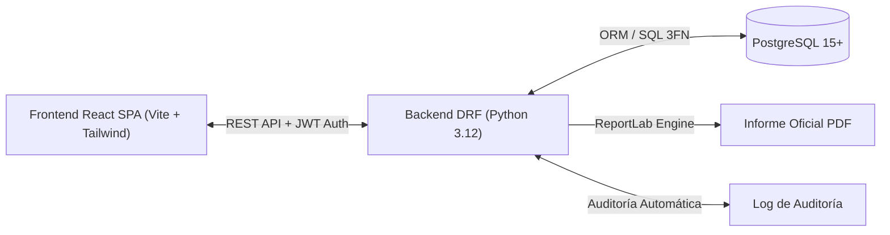
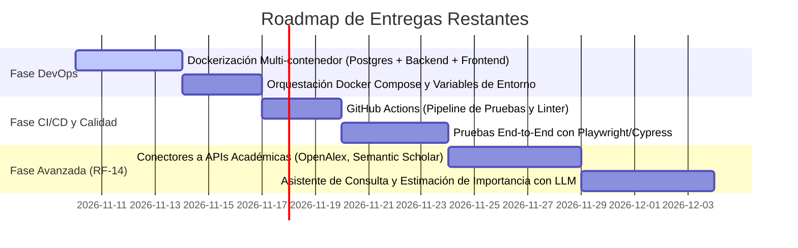

# Plan Maestro de Desarrollo — GUIOSPRO FLOSS Web (GUIOS+)

**Proyecto:** Sistema de Apoyo a las Decisiones para la Adopción de Software Libre (GUIOSAD / GUIOS+)  
**Base Teórica:** Tesis Doctoral *"Factores para la Adopción de Soluciones Basadas en Software Libre y Fuentes Abiertas"* (PhD. Víctor Hugo Rea Sánchez, Universidad de Sevilla, 2022)  
**Versión Actual:** 1.0.0-RC1  
**Fecha de Actualización:** Noviembre 2026  
**Repositorio:** [LuisAngulo02/GUIOS-](https://github.com/LuisAngulo02/GUIOS-)  

---

## 1. Visión General del Sistema y Estado del Proyecto

GUIOSPRO FLOSS Web (**GUIOS+**) es una plataforma web de nivel empresarial que automatiza el proceso de toma de decisiones para la adopción de software libre y de código abierto en organizaciones públicas y privadas.

El proyecto ha completado su fase central de desarrollo funcional y metodológico (**Sprints 1, 2 y 3 al 100%**), integrando la formulación matemática de la tesis doctoral con una arquitectura desacoplada moderna (**Django REST Framework + React SPA + PostgreSQL 3FN**), trazabilidad por auditoría y generación de informes oficiales en PDF.

---

## 2. Lo que ya tenemos implementado (Completado al 100%)

### 2.1. Sprint 1: Autenticación, Usuarios y Catálogo Maestro (HU-01 a HU-04)
- [x] **HU-01 (RF-01) — Registro e Inicio de Sesión Seguro:**
  - Autenticación con JSON Web Tokens (**SimpleJWT**) con par de claves `access` y `refresh`.
  - Contraseñas protegidas mediante algoritmos de derivación **Bcrypt**.
  - Política de seguridad contra fuerza bruta: control de `intentos_fallidos` (bloqueo temporal en `bloqueado_hasta` al 5.º intento por 15 minutos).
  - Erradicación de enumeración de cuentas en respuestas de error.
  - Lista negra de tokens (`token_blacklist`) y endpoint de cierre de sesión `/auth/logout/`.
- [x] **HU-02 (RF-02) — Gestión de Roles y Cuentas de Usuario:**
  - Control de Acceso Basado en Roles (**RBAC**) con roles diferenciados: `Administrador` y `Evaluador`.
  - Panel de administración de usuarios en React con filtrado reactivo por texto, rol y estado.
  - Implementación de **Baja Lógica** (`activo = FALSE`): las cuentas nunca se borran físicamente para no invalidar el histórico de evaluaciones.
  - Protección de degradación: prohibición estricta de auto-degradarse o eliminar la última cuenta administradora activa.
  - Bitácora de auditoría en tiempo real en la tabla `log_auditoria` de PostgreSQL.
- [x] **HU-03 (RF-03, RF-04) — Gestión del Catálogo de Evaluación GUIOS:**
  - Migración y población automática de los datos oficiales de la tesis (**3 Dimensiones, 18 Factores y 61 Subfactores `SF-01` a `SF-61`**).
  - Endpoints DRF administrativos `/api/v1/guios/admin/` protegidos con permiso `EsAdministrador`.
  - Pestaña interactiva **"Factores GUIOS"** con árbol jerárquico reactivo (Dimensión $\rightarrow$ Factor $\rightarrow$ Subfactores).
  - Modales para creación y edición de factores (escala de importancia 1-4, alcance `Interno`, `Externo`, `Ambos`) y subfactores con código único.
  - Bajas lógicas protegidas en catálogo para no alterar evaluaciones previas.
- [x] **HU-04 (RF-05, RF-06, RF-07) — Paso 1: Factores Relevantes e Importancia Relativa:**
  - Interfaz interactiva para asignación de la Importancia del Decisor ($ID \in [1, 4]$).
  - Cálculo instantáneo de la Importancia Relativa en el cliente y validación en backend:
    $$IR = \left\lfloor \frac{IS + ID}{2} \right\rfloor$$
  - Filtro estricto de relevancia: exclusión de factores con $IR = 1$ (`Irrelevante`) del paso posterior.
  - Gestión contextual del factor **Soporte** (alcance `Ambos`), exigiendo al evaluador especificar si es `Interno` o `Externo`.

---

### 2.2. Sprint 2: Evaluación Metodológica y Motor de Decisión (HU-05 y HU-06)
- [x] **HU-05 (RF-08) — Paso 2: Ponderación de Subfactores y Observaciones:**
  - Evaluación granular de cada reactivo en escala Likert discreta de 1 a 4:
    1. *No cumple el requisito*
    2. *Desconozco si cumple el requisito*
    3. *Cumple parcialmente el requisito*
    4. *Cumple el requisito*
  - Campo de texto para registrar justificaciones/observaciones por reactivo.
  - Cálculo dinámico de la Ponderación Media del Factor ($PM$):
    $$pm_i = \frac{1}{k}\sum_{j=1}^{k} PS_{i,j}$$
  - Bloqueo metodológico de completitud: validación estricta que impide avanzar al resultado o calcular recomendaciones si existen subfactores pendientes.
- [x] **HU-06 (RF-09, RF-10) — Paso 3: Matriz FODA y Dictamen Final:**
  - Clasificación automática en cuadrantes FODA con umbral fijo en $3.00$:
    - **Fortaleza:** $pm_i \ge 3.00$ y Alcance `Interno`.
    - **Oportunidad:** $pm_i \ge 3.00$ y Alcance `Externo`.
    - **Debilidad:** $pm_i < 3.00$ y Alcance `Interno`.
    - **Amenaza:** $pm_i < 3.00$ y Alcance `Externo`.
  - Detección de **Factores Críticos**: factores con $pm_i < 3.00$ cuya $IR$ sea **Importante ($3$)** o **Fundamental ($4$)**.
  - Reglas de Decisión Oficiales (Matriz de Decisión 2021):
    - **Recomendación A (Adoptar):** Ninguna debilidad ni amenaza ($pm_i \ge 3.00$ en todos).
    - **Recomendación B (Es posible adoptar con reservas):** Existen debilidades/amenazas únicamente en factores con $IR$ Opcional ($2$).
    - **Recomendación C (Requiere recursos antes de adoptar):** Al menos un factor crítico identificado.
  - Indicadores complementarios: **Índice de Viabilidad FLOSS (%)** y **Nivel de Confianza Metodológico** (Alto, Medio, Bajo).
  - Congelamiento inmutable del dictamen y desglose en la base de datos al finalizar la evaluación.

---

### 2.3. Sprint 3: Historial, Comparación y Reportes Oficiales (HU-07 y HU-08)
- [x] **HU-07 (RF-11, RF-12) — Dashboard e Historial de Evaluaciones:**
  - Vista general con métricas agregadas (totales, completadas, activas, viabilidad promedio).
  - Tabla de historial con filtros por nombre de software, rango de fechas y estado (`en_progreso`, `completada`).
  - Comparador lado a lado de 2 evaluaciones simultáneas para toma de decisiones comparativa entre soluciones alternativas.
  - Visualización congelada de evaluaciones finalizadas (inmunes a cambios posteriores en el catálogo).
- [x] **HU-08 (RF-13) — Generación y Descarga de Informe Oficial en PDF:**
  - Motor generador en backend con **ReportLab**:
    - Portada institucional formal con metadatos del software y evaluador.
    - Resumen metodológico y métricas globales (Viabilidad, Confianza, FODA).
    - Desglose por factores y subfactores evaluados con calificaciones y observaciones.
    - Cuadrantes FODA con resaltado visual de factores críticos.
    - Dictamen final con textos orientadores oficiales de la tesis doctoral.
  - Sanitización de strings contra inyección XML (`xml.sax.saxutils.escape`).

---

### 2.4. Hardening de Seguridad y Aseguramiento de Calidad (Transversal)
- [x] **Throttling y Rate Limiting:** Configurado en DRF para mitigar ataques DoS y fuerza bruta (10 peticiones/min en endpoints de autenticación, 60/min usuarios anónimos, 300/min usuarios autenticados).
- [x] **Cabeceras de Seguridad:** Activadas protecciones XSS, Clickjacking (`X-Frame-Options: DENY`), y `X-Content-Type-Options: nosniff`.
- [x] **Pruebas Automatizadas:** 19/19 pruebas unitarias y de integración pasando al 100% en Django (`guio_core` y `users`).
- [x] **Build Limpio Frontend:** Empaquetado exitoso en Vite/React sin errores de dependencias ni de sintaxis.

---

## 3. Matriz de Cobertura de Requisitos

| Código | Requisito / Historia | Tipo | Estado | Módulo Responsable |
| :--- | :--- | :---: | :---: | :--- |
| **RF-01 / HU-01** | Autenticación y Cuentas | Funcional | **Completado (100%)** | `users/` (JWT + Bcrypt) |
| **RF-02 / HU-02** | Gestión de Usuarios y Roles | Funcional | **Completado (100%)** | `users/`, `Administracion.jsx` |
| **RF-03 / HU-03** | Población Inicial del Catálogo | Funcional | **Completado (100%)** | `seed_catalog.py`, `guio_core` |
| **RF-04 / HU-03** | Mantenimiento del Catálogo (CRUD) | Funcional | **Completado (100%)** | `guio_core/views.py`, `Administracion.jsx` |
| **RF-05 / HU-04** | Ponderación de Importancia del Decisor | Funcional | **Completado (100%)** | `Paso1Factores.jsx`, `engine.py` |
| **RF-06 / HU-04** | Cálculo Automático de Importancia Relativa | Funcional | **Completado (100%)** | `engine.py`, `guiosFormula.js` |
| **RF-07 / HU-04** | Selección y Configuración de Alcance | Funcional | **Completado (100%)** | `Paso1Factores.jsx`, `guio_core` |
| **RF-08 / HU-05** | Calificación Granular de Subfactores | Funcional | **Completado (100%)** | `Paso2Subfactores.jsx` |
| **RF-09 / HU-06** | Generación de la Matriz FODA | Funcional | **Completado (100%)** | `Paso3Resultado.jsx`, `engine.py` |
| **RF-10 / HU-06** | Generación del Dictamen de Adopción | Funcional | **Completado (100%)** | `engine.py`, `guio_core` |
| **RF-11 / HU-07** | Consulta y Filtrado del Historial | Funcional | **Completado (100%)** | `Dashboard.jsx`, `HistorialModal.jsx` |
| **RF-12 / HU-07** | Comparación de Evaluaciones | Funcional | **Completado (100%)** | `ComparadorEvaluaciones.jsx` |
| **RF-13 / HU-08** | Exportación de Reporte en PDF | Funcional | **Completado (100%)** | `pdf_generator.py` |
| **RF-14 / Post-S3**| Búsqueda Asistida de Evidencia (IA) | Ampliación | **Pendiente / Roadmap** | `services/academicApis.js` |
| **RNF-01 a 08** | Rendimiento, Seguridad, Contenedores | No Funcional | **En Progreso (80%)** | Docker, Nginx, Compose |

---

## 4. Lo que Falta por Implementar (Roadmap hacia Versión Final)

A continuación se detallan las tareas pendientes organizadas por prioridad para el cierre del ciclo de vida del producto:

### 4.1. Fase 1: Despliegue y Contenedorización Docker (Prioridad Alta)
- [ ] **Dockerfile para Backend:**
  - Imagen base ligera `python:3.12-slim`.
  - Configuración de servidor WSGI de producción (`gunicorn` con workers gevent/uvicorn).
  - Recolección de estáticos (`collectstatic`) y usuario no privilegiado (`appuser`).
- [ ] **Dockerfile para Frontend:**
  - Construcción multi-etapa (*multi-stage build*): Etapa 1 con `node:20-alpine` (`npm run build`); Etapa 2 con `nginx:alpine` para servir assets estáticos de alto rendimiento con compresión gzip.
  - Archivo de configuración `nginx.conf` con reverse proxy configurado hacia `/api/v1/`.
- [ ] **Docker Compose (`docker-compose.yml`):**
  - Orquestación de 3 servicios:
    1. `db`: PostgreSQL 15 con volumen nombrado persistente (`pgdata`).
    2. `backend`: Django REST API enlazado a la base de datos con healthchecks.
    3. `frontend`: Nginx sirviendo la SPA y redirigiendo el tráfico del API.
  - Script de arranque unificado `entrypoint.sh` que aplique automáticamente migraciones y cargue los datos semilla (`seed_catalog`).

### 4.2. Fase 2: Pipeline de Integración Continua (CI/CD) (Prioridad Media)
- [ ] **GitHub Actions Workflow (`.github/workflows/ci.yml`):**
  - Job de Backend: ejecución de `flake8`/`black`, migraciones en base de datos temporal y suite completa `python manage.py test`.
  - Job de Frontend: ejecución de validación de sintaxis y empaquetado `npm run build`.
  - Bloqueo de Pull Requests que no aprueben el 100% de los tests.

### 4.3. Fase 3: Pruebas End-to-End (E2E) (Prioridad Media)
- [ ] Implementación de una suite de pruebas de extremo a extremo (con **Playwright** o **Cypress**) que simule:
  - Flujo completo de un evaluador: Login $\rightarrow$ Creación de evaluación $\rightarrow$ Paso 1 $\rightarrow$ Paso 2 $\rightarrow$ Paso 3 $\rightarrow$ Descarga de PDF.
  - Flujo de administrador: Gestión de usuarios $\rightarrow$ Creación de nuevo factor $\rightarrow$ Verificación de auditoría.

### 4.4. Fase 4: Módulo de Evidencia Bibliográfica y Asistente IA (RF-14 / Post-Sprint 3)
- [ ] Conectores a APIs académicas abiertas: **OpenAlex API** y **Semantic Scholar API**.
- [ ] Generación automática de cadenas de búsqueda booleanas por factor.
- [ ] Análisis de citas y cálculo sugerido para actualizar cuartiles de $IL$.
- [ ] Asistente de lenguaje natural para guiar al evaluador en la interpretación de los subfactores.

---

## 5. Próximos Pasos Inmediatos Recomendados

1. **Crear la configuración de Docker:**
   - Crear `backend/Dockerfile` o `Dockerfile` en raíz.
   - Crear `frontend/Dockerfile` y `frontend/nginx.conf`.
   - Crear `docker-compose.yml` y `.env.example`.
2. **Ejecutar y probar la contenedorización en local:**
   - Levantar el entorno con `docker-compose up --build`.
   - Verificar la inicialización de la base de datos y la conexión frontend-backend.
3. **Crear Pull Request e integrar en la rama principal:**
   - Fusionar la rama `feature/hu-03-crud-catalogo-factores` hacia `main`.