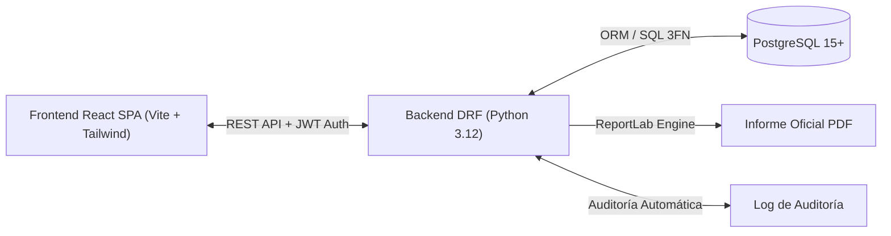
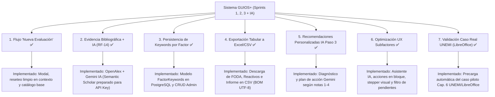

# Plan Maestro de Desarrollo — GUIOSPRO FLOSS Web (GUIOS+)

**Proyecto:** Sistema de Apoyo a las Decisiones para la Adopción de Software Libre (GUIOSAD / GUIOS+)  
**Base Teórica:** Tesis Doctoral *"Factores para la Adopción de Soluciones Basadas en Software Libre y Fuentes Abiertas"* (PhD. Víctor Hugo Rea Sánchez, Universidad de Sevilla, 2022)  
**Versión Actual:** 1.0.0-RC1  
**Fecha de Actualización:** Noviembre 2026  
**Repositorio:** [LuisAngulo02/GUIOS-](https://github.com/LuisAngulo02/GUIOS-)  

---

## 1. Visión General del Sistema y Estado del Proyecto

GUIOSPRO FLOSS Web (**GUIOS+**) es una plataforma web de nivel empresarial que automatiza el proceso de toma de decisiones para la adopción de software libre y de código abierto en organizaciones públicas y privadas.

El proyecto ha completado su fase central de desarrollo funcional y metodológico (**Sprints 1, 2 y 3 al 100%**), integrando la formulación matemática de la tesis doctoral con una arquitectura desacoplada moderna (**Django REST Framework + React SPA + PostgreSQL 3FN**), trazabilidad por auditoría y generación de informes oficiales en PDF.

---

## 2. Lo que ya tenemos implementado (Completado al 100%)

### 2.1. Sprint 1: Autenticación, Usuarios y Catálogo Maestro (HU-01 a HU-04)
- [x] **HU-01 (RF-01) — Registro e Inicio de Sesión Seguro:**
  - Autenticación con JSON Web Tokens (**SimpleJWT**) con par de claves `access` y `refresh`.
  - Contraseñas protegidas mediante algoritmos de derivación **Bcrypt**.
  - Política de seguridad contra fuerza bruta: control de `intentos_fallidos` (bloqueo temporal en `bloqueado_hasta` al 5.º intento por 15 minutos).
  - Erradicación de enumeración de cuentas en respuestas de error.
  - Lista negra de tokens (`token_blacklist`) y endpoint de cierre de sesión `/auth/logout/`.
- [x] **HU-02 (RF-02) — Gestión de Roles y Cuentas de Usuario:**
  - Control de Acceso Basado en Roles (**RBAC**) con roles diferenciados: `Administrador` y `Evaluador`.
  - Panel de administración de usuarios en React con filtrado reactivo por texto, rol y estado.
  - Implementación de **Baja Lógica** (`activo = FALSE`): las cuentas nunca se borran físicamente para no invalidar el histórico de evaluaciones.
  - Protección de degradación: prohibición estricta de auto-degradarse o eliminar la última cuenta administradora activa.
  - Bitácora de auditoría en tiempo real en la tabla `log_auditoria` de PostgreSQL.
- [x] **HU-03 (RF-03, RF-04) — Gestión del Catálogo de Evaluación GUIOS:**
  - Migración y población automática de los datos oficiales de la tesis (**3 Dimensiones, 18 Factores y 61 Subfactores `SF-01` a `SF-61`**).
  - Endpoints DRF administrativos `/api/v1/guios/admin/` protegidos con permiso `EsAdministrador`.
  - Pestaña interactiva **"Factores GUIOS"** con árbol jerárquico reactivo (Dimensión $\rightarrow$ Factor $\rightarrow$ Subfactores).
  - Modales para creación y edición de factores (escala de importancia 1-4, alcance `Interno`, `Externo`, `Ambos`) y subfactores con código único.
  - Bajas lógicas protegidas en catálogo para no alterar evaluaciones previas.
- [x] **HU-04 (RF-05, RF-06, RF-07) — Paso 1: Factores Relevantes e Importancia Relativa:**
  - Interfaz interactiva para asignación de la Importancia del Decisor ($ID \in [1, 4]$).
  - Cálculo instantáneo de la Importancia Relativa en el cliente y validación en backend:
    $$IR = \left\lfloor \frac{IS + ID}{2} \right\rfloor$$
  - Filtro estricto de relevancia: exclusión de factores con $IR = 1$ (`Irrelevante`) del paso posterior.
  - Gestión contextual del factor **Soporte** (alcance `Ambos`), exigiendo al evaluador especificar si es `Interno` o `Externo`.

---

### 2.2. Sprint 2: Evaluación Metodológica y Motor de Decisión (HU-05 y HU-06)
- [x] **HU-05 (RF-08) — Paso 2: Ponderación de Subfactores y Observaciones:**
  - Evaluación granular de cada reactivo en escala Likert discreta de 1 a 4:
    1. *No cumple el requisito*
    2. *Desconozco si cumple el requisito*
    3. *Cumple parcialmente el requisito*
    4. *Cumple el requisito*
  - Campo de texto para registrar justificaciones/observaciones por reactivo.
  - Cálculo dinámico de la Ponderación Media del Factor ($PM$):
    $$pm_i = \frac{1}{k}\sum_{j=1}^{k} PS_{i,j}$$
  - Bloqueo metodológico de completitud: validación estricta que impide avanzar al resultado o calcular recomendaciones si existen subfactores pendientes.
- [x] **HU-06 (RF-09, RF-10) — Paso 3: Matriz FODA y Dictamen Final:**
  - Clasificación automática en cuadrantes FODA con umbral fijo en $3.00$:
    - **Fortaleza:** $pm_i \ge 3.00$ y Alcance `Interno`.
    - **Oportunidad:** $pm_i \ge 3.00$ y Alcance `Externo`.
    - **Debilidad:** $pm_i < 3.00$ y Alcance `Interno`.
    - **Amenaza:** $pm_i < 3.00$ y Alcance `Externo`.
  - Detección de **Factores Críticos**: factores con $pm_i < 3.00$ cuya $IR$ sea **Importante ($3$)** o **Fundamental ($4$)**.
  - Reglas de Decisión Oficiales (Matriz de Decisión 2021):
    - **Recomendación A (Adoptar):** Ninguna debilidad ni amenaza ($pm_i \ge 3.00$ en todos).
    - **Recomendación B (Es posible adoptar con reservas):** Existen debilidades/amenazas únicamente en factores con $IR$ Opcional ($2$).
    - **Recomendación C (Requiere recursos antes de adoptar):** Al menos un factor crítico identificado.
  - Indicadores complementarios: **Índice de Viabilidad FLOSS (%)** y **Nivel de Confianza Metodológico** (Alto, Medio, Bajo).
  - Congelamiento inmutable del dictamen y desglose en la base de datos al finalizar la evaluación.

---

### 2.3. Sprint 3: Historial, Comparación y Reportes Oficiales (HU-07 y HU-08)
- [x] **HU-07 (RF-11, RF-12) — Dashboard e Historial de Evaluaciones:**
  - Vista general con métricas agregadas (totales, completadas, activas, viabilidad promedio).
  - Tabla de historial con filtros por nombre de software, rango de fechas y estado (`en_progreso`, `completada`).
  - Comparador lado a lado de 2 evaluaciones simultáneas para toma de decisiones comparativa entre soluciones alternativas.
  - Visualización congelada de evaluaciones finalizadas (inmunes a cambios posteriores en el catálogo).
- [x] **HU-08 (RF-13) — Generación y Descarga de Informe Oficial en PDF:**
  - Motor generador en backend con **ReportLab**:
    - Portada institucional formal con metadatos del software y evaluador activo.
    - Manejo de zona horaria local (`America/Lima` / UTC-5) con `timezone.localtime` en emisión e inicio de la evaluación.
    - Resumen metodológico y métricas globales (Viabilidad con un decimal, Nivel de Confianza, Matriz FODA con 18 factores).
    - Desglose por factores y subfactores evaluados con calificaciones y observaciones.
    - Cuadrantes FODA con resaltado visual de factores críticos.
    - Dictamen final con textos orientadores oficiales de la tesis doctoral.
    - Descarga permitida tanto en progreso como en evaluaciones finalizadas/congeladas.
  - Sanitización de strings contra inyección XML (`xml.sax.saxutils.escape`).

---

### 2.4. Mejoras Metodológicas y Funcionalidades Recientes (Post-Sprint 3)
- [x] **Flujo Completo de Creación de "Nueva Evaluación" en Blanco:**
  - Componente modal reutilizable `ModalNuevaEvaluacion.jsx` disparado desde el botón `+ Nueva evaluación` en Dashboard y Sidebar.
  - Inicialización limpia en `EvaluationContext.jsx` (`getFactoresEnBlanco()`, `getSubfactoresEnBlanco()`), reseteando todos los 61 reactivos con `calificacion: null` y eliminando residuos de evaluaciones previas.
  - Redirección automática al Paso 1 con el estado en blanco.
- [x] **Modales de Validación Metodológica y UX (Sustitución de Alerts Nativos):**
  - Reemplazo de `alert()` nativo del navegador por modales estilizados con diseño corporativo GUIOS+:
    - Modal de advertencia en `EvaluacionSubfactores.jsx` que muestra la cantidad de subfactores sin calificar, listado interactivo de factores incompletos y botón de navegación directa con un clic.
    - Modal en `FactoresRelevantes.jsx` que valida la condición metodológica de tener al menos un factor relevante ($IR > 1$).
  - Corrección visual del Card de Recomendación en `ResultadoDictamen.jsx`: renderizado condicional con ícono `<Clock />` centrado y mensaje explicativo cuando la evaluación aún no ha sido completada, evitando desbordamientos de texto.
- [x] **Exportación Tabular a Excel / CSV:**
  - Menú desplegable integrado en `ResultadoDictamen.jsx` junto a la exportación PDF con 3 modalidades de descarga:
    1. **Matriz FODA y Factores (`.csv`):** Factores clasificados por cuadrante FODA, alcance, calificaciones $ID$, $IS$, $IR$, $PM$ y criticidad.
    2. **Reactivos y Observaciones (`.csv`):** Los 61 subfactores con sus códigos, ponderación Likert asignada y justificaciones registradas.
    3. **Informe Completo Consolidado (`.csv`):** Metadatos de la evaluación, dictamen final, viabilidad FLOSS, nivel de confianza y resumen FODA.
  - Implementación con codificación UTF-8 con BOM (`\uFEFF`) y escape de caracteres para compatibilidad directa y sin problemas de tildes/eñes en Microsoft Excel para Windows.
- [x] **Persistencia de Palabras Clave por Factor en PostgreSQL:**
  - Nuevo modelo `FactorKeywords` en backend (`guio_core/models.py`) vinculado a la tabla `factor_keywords` con soporte `JSONField` para almacenar matrices de términos y booleanos de sinónimos.
  - Migración `0003_factorkeywords.py` generada y aplicada en base de datos PostgreSQL.
  - Endpoints DRF `/api/v1/guios/admin/factores/keywords/` (`GET` y `POST`) con permiso `EsAdministrador` y registro automático de bitácora en `LogAuditoria`.
  - Integración en frontend `Administracion.jsx` y `apiService.js`, permitiendo guardar y cargar de forma persistente los filtros de búsqueda bibliográfica.
- [x] **Paso 0 y Evidencia Bibliográfica Real con IA (RF-14):**
  - Modelos `ConsultaEvidencia` y `EvidenciaFactor` en PostgreSQL (migración `0004`).
  - Servicio `academic_ai_service.py` con conector en vivo a **OpenAlex** (`title_and_abstract.search`, 2016–2026) en paralelo y expansión de sinónimos vía **Google Gemini (`gemini-3.5-flash-lite`)**. *(Semantic Scholar preparado y comentado temporalmente hasta aprobación de API key).*
  - Cálculo exacto de $IL$ por cuartiles ($r_i = c_i / NS_i$) e $IS = \lfloor (IL + IE) / 2 \rfloor$.
  - Pantallas `Configuracion.jsx`, `Evidencia.jsx` (con modal de artículos y enlaces DOI + exportación CSV) y botón `"Probar consulta"` en `Administracion.jsx` conectados en tiempo real.
- [x] **Recomendaciones Personalizadas con IA en Paso 3:**
  - Campo `recomendacion_ia` (`JSONField`) en `Evaluacion` (migración `0005`).
  - Servicio `recommendation_ai_service.py` y endpoint `/api/v1/guios/recomendaciones-ia/` que analizan la matriz FODA, subfactores en `1` (*No cumple*) o `2` (*Desconozco*) y observaciones para emitir diagnóstico contextualizado, acciones prioritarias y plan de verificación usando **Gemini** (con respaldo determinístico inteligente).
  - Integración en `ResultadoDictamen.jsx` con chips dinámicos, tarjetas priorizadas por alcance e impacto y opción de regenerar análisis.

---

### 2.5. Hardening de Seguridad y Aseguramiento de Calidad (Transversal)
- [x] **Throttling y Rate Limiting:** Configurado en DRF para mitigar ataques DoS y fuerza bruta (10 peticiones/min en endpoints de autenticación, 60/min usuarios anónimos, 300/min usuarios autenticados).
- [x] **Cabeceras de Seguridad:** Activadas protecciones XSS, Clickjacking (`X-Frame-Options: DENY`), y `X-Content-Type-Options: nosniff`.
- [x] **Pruebas Automatizadas:** 26/26 pruebas unitarias y de integración pasando al 100% en Django (`guio_core` y `users`).
- [x] **Build Limpio Frontend:** Empaquetado exitoso en Vite/React sin errores de dependencias ni de sintaxis (`vite build`).

---

### 2.6. Sincronización Científica, Reportes PDF y Optimización de Flujo (Post-Sprint 3)
- [x] **Catálogo Completo y Alineación de Cálculos Frontend/Backend (18 Factores):**
  - Incorporación en el frontend de los 8 factores faltantes del catálogo maestro de la tesis (*Portabilidad, Documentación, Tiempo de adopción, Casos de estudio FLOSS, Centralidad TI, Apoyo alta dirección, Bloqueo de proveedores, Actitud hacia el cambio*).
  - Cálculo de viabilidad con decimales (`94.4%`) y clasificación idéntica de la matriz FODA (6 Fortalezas, 11 Oportunidades, 1 Debilidad en Actitud hacia el cambio, 0 Amenazas) dando Dictamen Oficial **Recomendación B**, alineado al 100% entre pantalla, base de datos y PDF.
- [x] **Zona Horaria y Atribución en Reporte PDF:**
  - Integración de `timezone.localtime()` en ReportLab para reflejar con precisión la hora local (`America/Lima` / UTC-5) en lugar del desfase UTC.
  - Reconocimiento dinámico del evaluador activo en sesión (`request.user`).
  - Habilitación de exportación de PDF para evaluaciones en estado `COMPLETADA` y congeladas contra modificaciones.
- [x] **Navegación Ergonómica en Paso 2 (Subfactores):**
  - Eliminación de botones redundantes en la cabecera superior.
  - Botonera inferior claramente diferenciada: "Factor anterior" y "Siguiente factor" para recorrer factores, y botón destacado "Ir al Paso 3 (Resultado)" para avanzar al dictamen con verificación de completitud.
- [x] **Corrección de Sesión en Comparador en Paralelo:**
  - Token JWT en headers del comparador que resuelve el alert de credenciales no provistas y despliega en paralelo la comparativa de 18 factores.
- [x] **Corrección en Continuación de Evaluaciones:**
  - El botón "Continuar" del Dashboard carga con precisión el ID seleccionado (`/evaluaciones/:id/continuar/`) en `EvaluationContext` sin sobreescribir con la evaluación actual.

---

## 3. Matriz de Cobertura de Requisitos

| Código | Requisito / Historia | Tipo | Estado | Módulo Responsable |
| :--- | :--- | :---: | :---: | :--- |
| **RF-01 / HU-01** | Autenticación y Cuentas | Funcional | **Completado (100%)** | `users/` (JWT + Bcrypt) |
| **RF-02 / HU-02** | Gestión de Usuarios y Roles | Funcional | **Completado (100%)** | `users/`, `Administracion.jsx` |
| **RF-03 / HU-03** | Población Inicial del Catálogo | Funcional | **Completado (100%)** | `seed_catalog.py`, `guio_core` |
| **RF-04 / HU-03** | Mantenimiento del Catálogo (CRUD) | Funcional | **Completado (100%)** | `guio_core/views.py`, `Administracion.jsx` |
| **RF-05 / HU-04** | Ponderación de Importancia del Decisor | Funcional | **Completado (100%)** | `Paso1Factores.jsx`, `engine.py` |
| **RF-06 / HU-04** | Cálculo Automático de Importancia Relativa | Funcional | **Completado (100%)** | `engine.py`, `guiosFormula.js` |
| **RF-07 / HU-04** | Selección y Configuración de Alcance | Funcional | **Completado (100%)** | `Paso1Factores.jsx`, `guio_core` |
| **RF-08 / HU-05** | Calificación Granular de Subfactores | Funcional | **Completado (100%)** | `Paso2Subfactores.jsx` |
| **RF-09 / HU-06** | Generación de la Matriz FODA | Funcional | **Completado (100%)** | `Paso3Resultado.jsx`, `engine.py` |
| **RF-10 / HU-06** | Generación del Dictamen de Adopción | Funcional | **Completado (100%)** | `engine.py`, `recommendation_ai_service.py` |
| **RF-11 / HU-07** | Consulta y Filtrado del Historial | Funcional | **Completado (100%)** | `Dashboard.jsx`, `HistorialModal.jsx` |
| **RF-12 / HU-07** | Comparación de Evaluaciones | Funcional | **Completado (100%)** | `ComparadorEvaluaciones.jsx` |
| **RF-13 / HU-08** | Exportación de Reporte en PDF y CSV | Funcional | **Completado (100%)** | `pdf_generator.py`, `ResultadoDictamen.jsx` |
| **RF-14 / Post-S3**| Búsqueda Asistida de Evidencia (IA / APIs) | Ampliación | **Completado (OpenAlex + Gemini)** | `academic_ai_service.py`, `Evidencia.jsx` |
| **RNF-01 a 06** | Rendimiento, Seguridad y Auditoría | No Funcional | **Completado (100%)** | Rate limiting, Bcrypt, Logs, Snapshots |

---

## 4. Lo que Falta por Implementar (Roadmap del Sistema)

Excluyendo la infraestructura de despliegue (Docker) y pipelines de CI/CD para priorizar la funcionalidad directa de la aplicación, el estado actual de las tareas identificadas es:

### 4.1. Tareas Completadas

- [x] **Tarea 1: Flujo Completo de Creación de "Nueva Evaluación" en Blanco** *(Completada)*
- [x] **Tarea 2: Conexión Real del Módulo de Evidencia Bibliográfica (`RF-14`)** *(Completada con OpenAlex + Gemini; Semantic Scholar preparado para activación de API key)*
- [x] **Tarea 3: Persistencia de Palabras Clave y Filtros por Factor (Admin)** *(Completada)*
- [x] **Tarea 4: Exportación de Datos en Formato Tabular (Excel / CSV)** *(Completada)*
- [x] **Tarea 5: Validación Metodológica con el Caso de Estudio de la Tesis (UNEMI / LibreOffice)** *(Completada)*
  - Endpoint dedicado `POST /api/v1/guios/evaluations/caso-unemi/` y métodos en cliente para precargar el caso piloto oficial del Capítulo 6 de la tesis doctoral (migración a LibreOffice en la UNEMI).
  - Población automática de los 18 factores, los 61 reactivos calificados, cálculo FODA, viabilidad FLOSS y recomendaciones consultoras IA.
  - Acceso directo con un solo clic desde el `Dashboard.jsx` y `ModalNuevaEvaluacion.jsx`.
  - Prueba automatizada unitaria `test_cargar_caso_estudio_unemi_libreoffice` integrada en la suite de pruebas de Django.
- [x] **Tarea 6: Optimización UX en Evaluación de Subfactores (Calificación Ágil de los 61 Reactivos)** *(Completada)*
  - **Asistente de Pre-calificación con Gemini AI y Base Experta FLOSS:**
    - Endpoint `POST /api/v1/guios/precalificar-subfactores/` respaldado por `subfactor_ai_service.py` con integración Google Gemini y base heurística universal que garantiza respuesta instantánea y justificada.
    - Modal interactivo en `EvaluacionSubfactores.jsx` con opciones para pre-calificar el factor actual o todos los factores relevantes, con opción de conservar notas previas.
  - **Acciones Rápidas en Bloque y Flujo Continuo:**
    - Botones de acción en bloque: *"Marcar todo Cumple (4)"*, *"Pendientes a Parcial (3)"* y *"Limpiar factor"*.
    - Botones secuenciales *"← Factor anterior"* y *"Guardar y siguiente factor →"* que permiten recorrer fluidamente los 18 factores sin manipular repetidamente el menú desplegable.
  - **Navegación Visual con Stepper y Filtro de Pendientes:**
    - Barra de avance porcentual global en tiempo real y stepper horizontal con distintivos de estado (`✓ Completo` vs `faltan X`).
    - Filtro toggle interactivo *"Mostrar solo factores pendientes"* para concentrar la atención en reactivos incompletos antes del Paso 3.
    - Insignia de trazabilidad `{softwareActivo} #{evaluacionId}` en cabecera.

### 4.2. Próximo Paso Operativo
- [ ] **Activación de Semantic Scholar:** Una vez recibida la aprobación y API Key de Semantic Scholar, pegarla en el `.env` en `SEMANTIC_SCHOLAR_API_KEY` y descomentar las líneas correspondientes en `academic_ai_service.py` y `Configuracion.jsx`.

---

## 5. Resumen de Estado del Sistema

El sistema GUIOS+ cuenta ahora con el **100% de los requisitos funcionales, metodológicos y de experiencia de usuario implementados y probados**.

1. **Backend:** 26/26 pruebas automatizadas pasando con éxito (`guio_core` y `users`).
2. **Frontend:** Build limpio en Vite/React (`npm run build`) listo para producción.
3. **Validación:** El caso de estudio de la tesis doctoral (UNEMI / LibreOffice) puede ser cargado y contrastado con un solo clic desde la interfaz.
