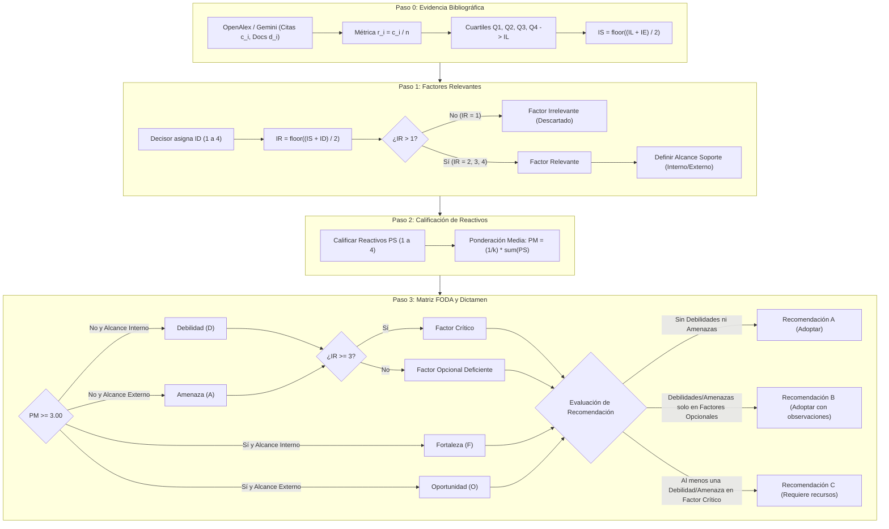
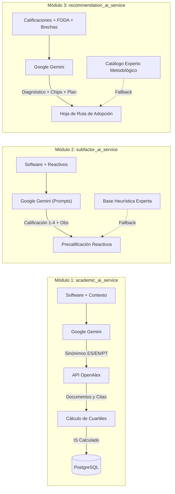
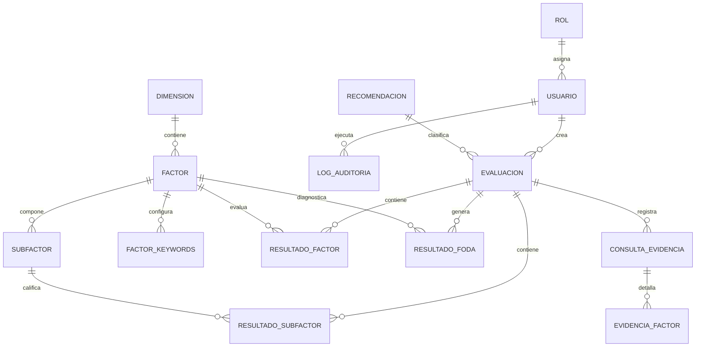

# CONTEXTO INTEGRAL DEL SISTEMA GUIOSPRO / GUIOS+
> **Documento de Contexto Técnico, Arquitectura, Inventario de Archivos, Lógica Matemática y Servicios de Inteligencia Artificial.**  
> *Versión del Sistema:* GUIOSPRO FLOSS Web (Marca UI: **GUIOS+** - *"Evaluación inteligente para adopción FLOSS"*)  
> *Base Académica:* Tesis Doctoral del **PhD. Víctor Hugo Rea Sánchez** (Universidad de Sevilla, 2022).

---

## 1. Resumen Ejecutivo, Origen Metodológico y Regla de Oro

### 1.1. Propósito del Sistema
**GUIOSPRO FLOSS Web** (presentado en la interfaz de usuario bajo la marca **GUIOS+**) es una plataforma web integral de apoyo a la toma de decisiones para la evaluación, selección y adopción de software libre y de código abierto (**FLOSS** - *Free/Libre and Open Source Software*). El sistema automatiza y digitaliza la guía metodológica **GUIOS**, transformando una evaluación manual compleja basada en hojas de cálculo y formularios en una solución web desacoplada de 3 capas, con persistencia relacional, control de acceso por roles, trazabilidad académica y asistencia inteligente mediante modelos de lenguaje (LLM).

### 1.2. Origen Académico
La metodología fue concebida y formulada por el **PhD. Víctor Hugo Rea Sánchez** en su tesis doctoral titulada *"Factores para la adopción de soluciones basadas en software libre y fuentes abiertas"* (Universidad de Sevilla, Departamento de Lenguajes y Sistemas Informáticos, junio de 2022), bajo la dirección del Dr. Pablo Neira Ayuso y el Dr. David Benavides Cuevas.

El sustento científico incluye:
1. **Revisión Sistemática de la Literatura (RSL):** Filtrado de $4429$ estudios iniciales en bases de datos indexadas (IEEE Xplore, ACM Digital Library, Scopus y Web of Science) entre 2008 y 2019, complementado con muestreo en bola de nieve para congresos, consolidando **54 estudios primarios de referencia**.
2. **Validación por Expertos Internacionales:** Consulta Delphi y validación estadística con **57 expertos internacionales** en adopción FLOSS (77.2% del sector público, 15.8% del sector privado, con más del 47% poseyendo más de 10 años de experiencia).
3. **Catálogo Metodológico Oficial:** Consolidado en **3 dimensiones**, **18 factores de influencia** y **61 subfactores/reactivos técnicos específicos**.

### 1.3. La Regla de Oro Metodológica
> **REGLA DE ORO INQUEBRANTABLE:**  
> La implementación web **preserva íntegramente la formulación matemática y metodológica de la tesis doctoral**:
> - Escalas discretas Likert de 1 a 4.
> - Cálculo exacto de la Importancia Sugerida ($IS$) a partir de cuartiles bibliográficos e importancia del experto.
> - Ecuación de la Importancia Relativa: $IR = \left\lfloor \frac{IS + ID}{2} \right\rfloor$.
> - Umbral de relevancia estricto: un factor es relevante si y solo si $IR > 1$.
> - Ponderación Media de subfactores ($PM$) en rango $[1.00, 4.00]$.
> - Clasificación FODA con umbral estricto en $3.00$ según alcance Interno/Externo.
> - Reglas oficiales de inferencia para dictámenes de recomendación **A**, **B** o **C**.
>
> La innovación del software recae en la arquitectura en la nube, la persistencia en PostgreSQL, la seguridad con JWT/Bcrypt, la generación vectorial de informes en PDF y la integración de Inteligencia Artificial para enriquecimiento bibliográfico, precalificación y hojas de ruta de adopción.

---

## 2. Mapa y Descripción Estructural de Carpetas

A continuación se detalla la jerarquía completa de carpetas del repositorio y la responsabilidad arquitectónica de cada una:

```text
GUIOSPRO/
├── data/                         # Datasets maestros de la tesis y archivos de calibración
├── docs/                         # Documentación técnica, arquitectónica y académica
│   └── tesis/                    # Referencias directas de la tesis doctoral
├── guiospro_backend/             # Configuración raíz del proyecto Django REST Framework
├── guio_core/                    # Aplicación núcleo: modelos metodológicos, vistas y motores
│   ├── engine/                   # Motor matemático puro desacoplado y carga de datasets
│   ├── management/               # Comandos personalizados de Django (seeders, scripts)
│   │   └── commands/
│   ├── migrations/               # Migraciones de esquema PostgreSQL de guio_core
│   └── services/                 # Servicios de IA (Gemini), bibliometría y recomendaciones
├── users/                        # Aplicación de autenticación, usuarios, roles y seguridad
│   └── migrations/               # Migraciones de esquema de users
└── frontend/                     # Aplicación cliente SPA (React 18 + Vite + Tailwind CSS)
    ├── public/                   # Recursos estáticos servidos directamente (íconos, favicons)
    └── src/                      # Código fuente de React
        ├── assets/               # Imágenes, logotipos e ilustraciones
        ├── components/           # Componentes UI reutilizables (tablas, cuadrantes, botones)
        ├── context/              # Contexto global de evaluación y estado de React
        ├── data/                 # Mocks locales de contingencia offline (catálogo y evidencia)
        ├── layouts/              # Layout principal con navegación superior y lateral
        ├── pages/                # Vistas de la aplicación correspondientes a cada paso
        └── services/             # Cliente HTTP (fetch) con interceptor JWT y fallback
```

### Detalle de Responsabilidad por Carpeta:

1. **`data/`**: Contiene los archivos delimitados por tabulaciones (TSV/CSV) y hojas de cálculo extraídas del prototipo GUIOSAD v0.1.2 y la tesis doctoral. Sirve como fuente primaria de datos para la siembra de base de datos (`seed_catalog.py`) y pruebas fuera de línea.
2. **`docs/`**: Alberga la documentación del ciclo de desarrollo del sistema, planes de sprints, especificaciones de la tesis doctoral y este archivo maestro de contexto.
3. **`guiospro_backend/`**: Directorio de configuración global de Django (`settings.py`, `urls.py`, `wsgi.py`, `asgi.py`). Coordina las aplicaciones instaladas, orquesta SimpleJWT, CORS, conexión a PostgreSQL y configuración de APIs externas.
4. **`guio_core/`**: Es el cerebro metodológico del sistema. Define los 15 modelos relacionales principales, endpoints REST para cada paso de la evaluación (Paso 0 a Paso 3), generación de reportes ejecutivos en PDF con ReportLab, y alberga los algoritmos matemáticos y de IA.
   - `guio_core/engine/`: Módulo de Python puro sin dependencias directas del ORM de Django, ideal para pruebas unitarias de regresión matemática pura.
   - `guio_core/services/`: Capa de integración con servicios externos: Google Gemini API (modelos `gemini-flash-lite-latest`), OpenAlex API para consultas bibliográficas en tiempo real y motores de inferencia experta.
   - `guio_core/management/commands/`: Scripts de administración invocables mediante `python manage.py` para inicializar el catálogo de 18 factores y crear usuarios por defecto.
5. **`users/`**: Gestiona la seguridad perimetral del sistema. Controla la autenticación con tokens JWT, políticas de contraseñas con hash Bcrypt, control de intentos fallidos (bloqueo tras 5 intentos erróneos), restablecimiento seguro de contraseña por correo SMTP y control de acceso basado en roles (`administrador` y `evaluador`).
6. **`frontend/`**: Proyecto frontend construido sobre Vite, React 18 y Tailwind CSS. Implementa la identidad visual institucional de **GUIOS+** (tonos verdes `#3F6F58`, tarjetas limpias, visualización FODA $2\times2$ y soporte responsivo).

---

## 3. Inventario Detallado Archivo por Archivo

En esta sección se especifica exactamente qué hace cada uno de los archivos del repositorio:

### 3.1. Archivos en la Raíz del Proyecto

* **`.env`**: Archivo local de variables de entorno (no versionado en repositorios públicos). Contiene claves secretas de Django (`SECRET_KEY`), credenciales de la base de datos PostgreSQL (`DATABASE_URL` o `DB_NAME`, `DB_USER`, `DB_PASSWORD`), clave de API de Google Gemini (`GEMINI_API_KEY`), configuración de OpenAlex (`OPENALEX_EMAIL`, `OPENALEX_API_KEY`), y parámetros de correo SMTP de Google para recuperación de contraseñas.
* **`.env.example`**: Plantilla documentada con todas las variables de entorno necesarias para desplegar el proyecto en desarrollo o producción.
* **`.gitignore`**: Reglas de exclusión de Git para evitar subir entornos virtuales (`venv/`, `.venv/`), archivos compilados de Python (`__pycache__/`, `*.pyc`), dependencias de Node.js (`node_modules/`), artefactos de compilación (`dist/`, `build/`) y variables de entorno (`.env`).
* **`build.sh`**: Script bash de automatización para entornos PaaS (Render, Railway, Heroku). Instala dependencias de Python con `pip`, compila los activos del frontend con `npm run build`, ejecuta la recolección de estáticos (`python manage.py collectstatic --no-input`) y corre las migraciones de PostgreSQL (`python manage.py migrate`).
* **`crear_usuarios.py`**: Script de utilidad ejecutable directamente para asegurar la existencia de usuarios iniciales en la base de datos (administrador `admin@guiospro.com` y evaluador de prueba).
* **`FLUJO_DEL_SISTEMA.md`**: Documento de arquitectura visual que describe mediante diagramas de secuencia Mermaid y diagramas de flujo el recorrido completo del usuario desde el inicio de sesión hasta la emisión del dictamen y descarga de PDF.
* **`manage.py`**: Interfaz de línea de comandos estándar de Django para ejecutar tareas administrativas, migraciones, pruebas unitarias y el servidor de desarrollo.
* **`MANUAL_DE_USUARIO.md`**: Guía operativa orientada al usuario final y decisores de TI. Explica el uso paso a paso de cada pantalla, la interpretación de las escalas y cómo leer el dictamen y la matriz FODA.
* **`Procfile`**: Declaración de procesos para despliegue en contenedores Heroku/Render, configurado para levantar el servidor WSGI mediante Gunicorn: `web: gunicorn guiospro_backend.wsgi --log-file -`.
* **`README.md`**: Documento introductorio general del repositorio. Proporciona instrucciones de instalación rápida, prerrequisitos, scripts de arranque simultáneo de frontend y backend, y resumen de arquitectura.
* **`requirements.txt`**: Manifiesto de paquetes de Python requeridos por el backend. Incluye: Django 5+, djangorestframework, djangorestframework-simplejwt, psycopg2-binary, reportlab (PDFs), numpy, pandas, openpyxl, google-generativeai, django-cors-headers, gunicorn, dj-database-url y python-dotenv.

---

### 3.2. Carpeta `data/`

* **`data/factors.csv`**: Archivo delimitado por tabulaciones que define los 18 factores base de la metodología GUIOS, su dimensión asociada, la importancia sugerida por defecto ($IS$) de acuerdo al prototipo GUIOSAD, y su alcance inicial (`Interno`, `Externo` o `Ambos`).
* **`data/guiosad_data.csv`**: Archivo maestro estructurado en 3 columnas tabuladas (`Dimensión`, `Factor`, `Subfactor`) que contiene la relación jerárquica de los 61 subfactores de la tesis doctoral.
* **`data/MATRIZ RECOMENDACION GUIOSAD 2021.xlsx`**: Hoja de cálculo de validación original empleada durante la tesis y los primeros prototipos en Flexx/Tornado. Contiene las matrices de confusión y casos de prueba para recomendaciones A, B y C.

---

### 3.3. Carpeta `docs/`

* **`docs/context.md`**: (Este archivo). Documento maestro integral con todo el contexto técnico, descripción de archivos, fórmulas matemáticas y servicios de IA.
* **`docs/PLAN_DE_DESARROLLO.md`**: Plan de trabajo dividido en Sprints y tareas funcionales (HU-01 a HU-08, RF-01 a RF-14), con asignación de historias de usuario y criterios de aceptación.
* **`docs/tesis/README.md`**: Documento de síntesis académica que detalla las citas bibliográficas, el proceso de filtrado de 4429 a 54 estudios primarios y el listado de expertos participantes en la investigación doctoral.

---

### 3.4. Carpeta `guiospro_backend/` (Configuración Django)

* **`guiospro_backend/__init__.py`**: Define el directorio como un paquete de Python.
* **`guiospro_backend/asgi.py`**: Interfaz de servidor asíncrono para despliegues compatibles con ASGI.
* **`guiospro_backend/wsgi.py`**: Interfaz de servidor síncrono estándar utilizada por Gunicorn para servir la API en entornos de producción.
* **`guiospro_backend/settings.py`**: Archivo central de configuración de Django. Orquesta:
  - Definición de `AUTH_USER_MODEL = 'guio_core.Usuario'`.
  - Configuración de base de datos relacional PostgreSQL con fallback dinámico.
  - Parámetros de seguridad de Django REST Framework y SimpleJWT (rotación de tokens, tiempo de vida de access token de 60 minutos, refresh token de 7 días, lista negra de tokens revocados).
  - Configuración de CORS (`django-cors-headers`) para permitir peticiones del cliente React en puertos de desarrollo (`localhost:5173`) y producción.
  - Conexión al servidor de correo SMTP de Google para restablecimiento de contraseñas.
  - Variables de integración para Google Gemini API y OpenAlex API.
  - Configuración de rate limiting (`DEFAULT_THROTTLE_CLASSES` y `DEFAULT_THROTTLE_RATES`) para protección contra fuerza bruta en endpoints de login y registro.
* **`guiospro_backend/urls.py`**: Enrutador raíz de URLs de la API REST:
  - `/admin/`: Panel de control nativo de Django Admin.
  - `/api/v1/auth/token/`: Obtención directa de pares de tokens JWT.
  - `/api/v1/auth/token/refresh/`: Renovación de access tokens expirados.
  - `/api/v1/users/`: Incluye el enrutador de la aplicación `users` (login, logout, registro, perfiles, administración de cuentas y recuperación de clave).
  - `/api/v1/guios/`: Incluye el enrutador de `guio_core` (catálogo, evaluaciones, pasos 1 a 3, PDF, evidencia e IA).

---

### 3.5. Carpeta `guio_core/` (Núcleo Metodológico y Negocio)

* **`guio_core/__init__.py`**: Define la aplicación Django.
* **`guio_core/admin.py`**: Registro de modelos en el panel Django Admin tradicional para tareas de soporte técnico.
* **`guio_core/apps.py`**: Declaración de la clase `GuioCoreConfig` para la inicialización de la app.
* **`guio_core/models.py`**: Definición del esquema relacional en PostgreSQL (15 modelos diseñados en Tercera Forma Normal - 3FN):
  1. `Rol`: Catálogo de perfiles de usuario (`administrador`, `evaluador`).
  2. `Usuario`: Modelo de usuario personalizado con autenticación por email, hash Bcrypt, campos `activo` (baja lógica), `intentos_fallidos` y `bloqueado_hasta`.
  3. `Dimension`: Las 3 dimensiones maestras de análisis (`Tecnológica`, `Organizacional`, `Económica`).
  4. `Factor`: Los 18 factores de influencia con su dimensión foránea, importancia de literatura base ($IS$) y alcance inicial (`Interno`, `Externo`, `Ambos`).
  5. `Subfactor`: Los 61 reactivos específicos (`SF-01` a `SF-61`) vinculados a su factor padre.
  6. `Recomendacion`: Catálogo de dictámenes finales (Tipos **A**, **B** y **C**), con reglas de inferencia y textos orientadores de la tesis doctoral.
  7. `Evaluacion`: Instancia de evaluación de una solución FLOSS concreta realizada por un usuario. Almacena estado (`en_progreso`, `completada`, `cancelada`), fechas, índice de viabilidad, nivel de confianza, copia congelada inmutable del dictamen (`dictamen_texto`) y campo JSON con recomendaciones de IA (`recomendacion_ia`).
  8. `ResultadoFactor`: Persistencia de las decisiones del Paso 1: importancia del decisor ($ID$), importancia relativa calculada ($IR$), alcance aplicado y nombre del factor congelado en el momento de la evaluación.
  9. `ResultadoSubfactor`: Calificaciones del Paso 2: puntaje Likert (1 a 4) y observación técnica obligatoria para cada reactivo evaluado.
  10. `ResultadoFoda`: Resultados del Paso 3: Ponderación Media ($PM$), cuadrante asignado (`fortaleza`, `oportunidad`, `debilidad`, `amenaza`) y marca booleana `critico`.
  11. `LogAuditoria`: Bitácora inmutable de eventos del sistema (usuario, acción, entidad, ID de entidad, detalle y timestamp).
  12. `FactorKeywords`: Términos de búsqueda clave personalizados y configuración de sinónimos para la búsqueda bibliográfica de cada factor.
  13. `ConsultaEvidencia`: Registro maestro de las búsquedas bibliográficas realizadas en el Paso 0 (software, contexto, fuentes consultadas, total de documentos, citas y ventana temporal).
  14. `EvidenciaFactor`: Detalle de métricas bibliográficas ($IL$, $IE$, $IS$, documentos, citas, autores) asociadas a cada factor en una consulta de evidencia.
  15. `ParametroGlobal`: Almacenamiento clave-valor de configuración global del sistema (umbrales de cálculo, años de ventana temporal e idiomas de búsqueda).
* **`guio_core/serializers.py`**: Serializadores de Django REST Framework encargados de transformar objetos del ORM a JSON y viceversa, con rigurosas validaciones metodológicas:
  - `SubfactorCatalogoSerializer`, `FactorCatalogoSerializer`, `DimensionCatalogoSerializer`: Serialización estructurada del catálogo maestro.
  - `CrearEvaluacionSerializer`: Validación para el alta de nuevas evaluaciones (software obligatorio, contexto opcional).
  - `GuardarPaso1Serializer`: Valida que los 18 factores reciban una importancia del decisor entre 1 y 4, y que si el factor *Soporte* resulta relevante, se haya especificado obligatoriamente su alcance (`Interno` o `Externo`).
  - `GuardarPaso2Serializer`: Valida la recepción de calificaciones discretas (1 a 4) y observaciones técnicas para los reactivos de los factores relevantes.
  - `ResultadoFactorSerializer`, `ResultadoSubfactorSerializer`, `ResultadoFodaSerializer`: Presentación de resultados calculados.
  - `EvaluacionDetalleSerializer`: Serializador maestro que entrega el estado completo y anidado de una evaluación.
* **`guio_core/views.py`**: Controlador de lógica de negocio y endpoints REST:
  - `CatalogoView`: Retorna la jerarquía completa de dimensiones, factores, subfactores y recomendaciones.
  - `EvaluacionViewSet`: ViewSet que implementa CRUD completo de evaluaciones y acciones personalizadas:
    - `guardar_paso1`: Calcula en el servidor $IR = \lfloor (IS + ID)/2 \rfloor$, valida el factor Soporte y persiste en `ResultadoFactor`.
    - `paso2`: En método `GET` entrega los reactivos de factores relevantes pendientes de calificar; en método `POST` valida y guarda notas Likert (1-4) y observaciones.
    - `paso3`: Ejecuta el motor FODA interno, computa Ponderación Media ($PM$), determina el cuadrante FODA, evalúa factores críticos, define la recomendación A, B o C, calcula el índice de viabilidad y nivel de confianza, y congela el dictamen en base de datos.
    - `informe_pdf`: Invoca el generador ReportLab y entrega el binario PDF en streaming (`application/pdf`).
    - `cargar_caso_unemi`: Precarga los datos oficiales del caso de estudio de la Universidad Estatal de Milagro (UNEMI) sobre LibreOffice documentado en el Capítulo 6 de la tesis doctoral.
  - `AdminDimensionesViewSet`, `AdminFactoresViewSet`, `AdminSubfactoresViewSet`: Módulos CRUD con baja lógica (`activo = False`) y registro automático en `LogAuditoria`.
  - `EvidenciaView`, `CalcularEvidenciaView`, `RestaurarEvidenciaView`: Endpoints para ejecutar la búsqueda bibliográfica en OpenAlex y recomputar $IS$.
  - `PrecalificarSubfactoresIAView`: Endpoint que conecta con el asistente de IA para calificar automáticamente los reactivos de la evaluación.
  - `RecomendacionesIAView`: Genera diagnósticos ejecutivos, chips de acción y planes de contingencia mediante Gemini.
  - `AdminHistorialConsultasView`, `AdminParametrosCalculoView`: Gestión de auditoría bibliográfica y configuración del sistema.
* **`guio_core/urls.py`**: Enrutamiento interno de endpoints de `guio_core`.
* **`guio_core/pdf_generator.py`**: Módulo especializado para la generación del informe oficial en PDF mediante **ReportLab**:
  - Utiliza `NumberedCanvas` en dos pasadas para calcular la paginación dinámica exacta (*"Página X de Y"*).
  - Incluye portada institucional con membrete, título, metadatos del evaluador, resumen ejecutivo, semáforo visual de la recomendación obtenida (verde para A, naranja para B, rojo para C), tabla matricial FODA $2\times2$, desglose dimensional y anexo de trazabilidad con los 61 reactivos y sus observaciones técnicas.
  - Incorpora saneamiento de caracteres XML (`xml_escape`) para evitar inyecciones o fallas de renderizado.
* **`guio_core/tests.py`**: Suite de pruebas automatizadas que valida la consistencia matemática del cálculo de $IR$, umbrales de Ponderación Media ($PM$), asignaciones FODA y transiciones de recomendación A, B y C.

#### Subcarpeta `guio_core/engine/` (Motor Puro Desacoplado)
* **`guio_core/engine/__init__.py`**: Paquete del motor matemático.
* **`guio_core/engine/domain_models.py`**: Clases de dominio puro (`dataclasses`) y enumeraciones (`Enum`):
  - `ImportanceLevel`: Enumeración de 1 a 4 (`IRRELEVANTE`, `OPCIONAL`, `IMPORTANTE`, `FUNDAMENTAL`).
  - `SubfactorComplianceLevel`: Calificación de reactivos (`NO_CUMPLE`, `CUMPLE_PARCIALMENTE`, `CUMPLE_SATISFACTORIAMENTE`, `CUMPLE_TOTALMENTE`).
  - `Scope`: Ámbito del factor (`INTERNO`, `EXTERNO`, `AMBOS`).
  - `FodaCategory`: Cuadrantes FODA (`FORTALEZA`, `OPORTUNIDAD`, `DEBILIDAD`, `AMENAZA`).
  - `RecommendationType`: Tipos de dictamen (`RECOMENDACION_A`, `RECOMENDACION_B`, `RECOMENDACION_C`).
* **`guio_core/engine/calculator.py`**: Implementación en Python puro de las reglas de decisión de la tesis:
  - `calculate_relative_importance(suggested, decisor)`: Implementa la fórmula cartesiana $IR = \lfloor (IS + ID)/2 \rfloor$.
  - `is_relevant(relative_importance)`: Determina si $IR > 1$.
  - `calculate_average_weight(scores)`: Promedio aritmético $PM = \sum / n$.
  - `classify_foda(scope, average_weight)`: Asigna cuadrante según umbral $3.00$.
  - `evaluate_recommendation(evaluated_factors)`: Regla lógica de adopción A, B o C.
* **`guio_core/engine/data_loader.py`**: Módulo utilitario que utiliza `pandas` para parsear los archivos `factors.csv` y `guiosad_data.csv`, construyendo la estructura en memoria de dimensiones, factores y subfactores.

#### Subcarpeta `guio_core/services/` (Servicios de IA y Bibliometría)
* **`guio_core/services/__init__.py`**: Paquete de servicios de integración.
* **`guio_core/services/academic_ai_service.py`**: Servicio del Paso 0. Orquesta:
  1. Expansión de sinónimos técnicos multilingües (español, inglés, portugués) llamando a Google Gemini API (`gemini-flash-lite-latest`) con salida estructurada en JSON.
  2. Consulta HTTP concurrente (`ThreadPoolExecutor`) a la API abierta de **OpenAlex**, buscando documentos y citas acumuladas asociadas a las palabras clave de cada factor para el software evaluado en una ventana de años determinada.
  3. Mecanismo de contingencia (*fallback*): si la API de OpenAlex responde con límite de peticiones (código HTTP 429) o fallas de red, activa automáticamente los datos del benchmark empírico de la Revisión Sistemática de Literatura (RSL) de la tesis doctoral (54 estudios Scopus/WoS).
  4. Cálculo de densidad bibliográfica continua y discretización por **cuartiles ($Q_1$ a $Q_4$)** para calcular la Importancia de la Literatura ($IL$) y la Importancia Sugerida ($IS$).
* **`guio_core/services/recommendation_ai_service.py`**: Servicio del Paso 3. Orquesta:
  1. Extracción y análisis de factores con calificación deficiente ($PM < 3.00$), distinguiendo factores críticos (IR $\ge 3$) de factores opcionales (IR $= 2$).
  2. Generación con Gemini de diagnósticos ejecutivos específicos, alertas técnicas, planes de mitigación cronológicos (Semanas 1 a 6) y directrices de gobernanza de TI adaptadas al contexto institucional del usuario.
  3. Respaldo de conocimiento metodológico determinista (`CATALOGO_EXPERTO_FACTORES`) con acciones, entregables y plazos técnicos para cada uno de los 18 factores de la tesis doctoral.
* **`guio_core/services/subfactor_ai_service.py`**: Asistente de precalificación ágil para el Paso 2:
  1. Permite sugerir calificaciones Likert (1 a 4) y justificaciones técnicas para los 61 reactivos de la guía metodológica GUIOS.
  2. Conecta con Gemini mediante prompts contextualizados con el software y caso de uso.
  3. Integra una base experta determinista para soluciones de software reconocidas (ej. LibreOffice) y un catálogo de reglas heurísticas universales para cualquier solución FLOSS.

#### Subcarpeta `guio_core/management/commands/`
* **`guio_core/management/commands/__init__.py`**: Paquete de comandos de gestión.
* **`guio_core/management/commands/crear_usuarios.py`**: Comando ejecutable (`python manage.py crear_usuarios`) que inicializa los roles `administrador` y `evaluador`, y crea las cuentas base de prueba.
* **`guio_core/management/commands/seed_catalog.py`**: Comando ejecutable (`python manage.py seed_catalog`) que puebla la base de datos con las 3 dimensiones, los 18 factores con su $IS$ base, los 61 subfactores y las 3 recomendaciones oficiales.

---

### 3.6. Carpeta `users/` (Autenticación y Control de Acceso)

* **`users/__init__.py`**: Paquete de la aplicación de usuarios.
* **`users/admin.py`**: Configuración de administración para modelos de usuarios.
* **`users/apps.py`**: Configuración de la aplicación `users`.
* **`users/models.py`**: Modelo unificado (la clase principal `Usuario` se centraliza en `guio_core.models.Usuario` para evitar redundancia).
* **`users/permissions.py`**: Clases de permisos de Django REST Framework:
  - `EsAdministrador`: Permite el acceso únicamente a usuarios cuyo rol sea `administrador` o posean `is_superuser = True`.
  - `EsEvaluadorOAdmin`: Permite el acceso a evaluadores y administradores autenticados.
  - `EsPropietarioOAdmin`: Restringe la lectura o edición de una evaluación únicamente al evaluador que la creó o a un administrador.
* **`users/serializers.py`**: Serializadores de seguridad:
  - `LoginSerializer`: Validación de email y contraseña contra hash Bcrypt, control de intentos fallidos y retorno de tokens JWT firmados.
  - `RegistroUsuarioSerializer`: Alta de nuevos evaluadores con validación de complejidad de contraseña y asignación por defecto del rol evaluador.
  - `UsuarioPerfilSerializer`: Información de perfil del usuario logueado.
  - `AdminUsuarioSerializer`: Serializador para que los administradores puedan dar de alta, editar roles o cambiar el estado activo/inactivo de cualquier cuenta.
  - `PasswordResetRequestSerializer` y `PasswordResetConfirmSerializer`: Gestión del flujo de restablecimiento de contraseña mediante tokens firmados con HMAC y codificación `uidb64`.
* **`users/views.py`**: Controladores de autenticación:
  - `LoginView`: Endpoint de inicio de sesión con control de fuerza bruta (bloqueo por 15 minutos tras 5 intentos fallidos) y rate limiting.
  - `LogoutView`: Cierre de sesión e invalidación del token mediante lista negra (`blacklist`).
  - `RegistroView`: Endpoint público de registro de nuevos evaluadores.
  - `PerfilView`: Consulta y actualización de datos del usuario en sesión.
  - `AdminUsuariosViewSet`: CRUD administrativo de usuarios con baja lógica y protección para no permitir la eliminación o bloqueo del último administrador activo.
  - `PasswordResetRequestView` y `PasswordResetConfirmView`: Generación de enlaces seguros de recuperación, despacho de correos electrónicos con identidad visual GUIOS+ vía SMTP y actualización segura de contraseñas.
* **`users/urls.py`**: Enrutamiento de URLs para el módulo de seguridad (`auth/login/`, `auth/logout/`, `auth/register/`, `auth/refresh/`, `auth/password-reset/`, etc.).
* **`users/tests.py`**: Pruebas unitarias de autenticación, control de fuerza bruta y políticas de permisos.

---

### 3.7. Carpeta `frontend/` (Cliente Web React + Vite)

#### Archivos de Configuración Raíz del Frontend:
* **`frontend/package.json`**: Manifiesto de dependencias de Node.js. Incluye: React 18, React DOM, React Router DOM 6, Vite, Tailwind CSS, Autoprefixer, PostCSS, Lucide React (iconografía).
* **`frontend/vite.config.js`**: Configuración de Vite. Configura el plugin de `@vitejs/plugin-react` y el puerto de desarrollo local (5173).
* **`frontend/tailwind.config.js`**: Configuración de Tailwind CSS con los colores de marca de GUIOS+ (verdes institucionales `#3F6F58`, `#2F5444`, grises neutros y estados de alerta para la matriz FODA).
* **`frontend/postcss.config.js`**: Orquestación de PostCSS con Tailwind CSS y Autoprefixer.
* **`frontend/index.html`**: Documento HTML5 de entrada con metatags, tipografías y el contenedor `<div id="root"></div>`.
* **`frontend/.oxlintrc.json`**: Configuración del linter estático de código.
* **`frontend/vercel.json`**: Reglas de reescritura de rutas para despliegues estáticos en Vercel (*Single Page Application routing*).

#### Subcarpeta `frontend/src/`:
* **`frontend/src/main.jsx`**: Punto de entrada de JavaScript. Monta el componente raíz `App` en el DOM dentro de `React.StrictMode`.
* **`frontend/src/App.jsx`**: Componente central de enrutamiento. Envuelve la aplicación en `EvaluationProvider` y define las rutas con `BrowserRouter`:
  - Rutas públicas: `/login`, `/registro`, `/reset-password`.
  - Rutas privadas bajo `MainLayout`: `/dashboard`, `/configuracion`, `/factores`, `/subfactores`, `/resultado`, `/evidencia`, `/administracion` (protegida para administradores mediante el componente `ProtectedRoute`).
* **`frontend/src/index.css` & `src/App.css`**: Definición de directivas de Tailwind (`@tailwind base; @tailwind components; @tailwind utilities;`) y personalizaciones visuales globales.

#### Subcarpeta `frontend/src/context/`:
* **`frontend/src/context/EvaluationContext.jsx`**: Contexto React central del frontend (`EvaluationContext` y hook `useEvaluation`). Administra el estado reactivo global:
  - Sesión del usuario actual y tokens JWT.
  - Evaluación activa (ID, nombre del software, contexto de uso, estado).
  - Listado de evaluaciones y funciones para crear, seleccionar o cambiar de evaluación activa.
  - Estado de los 18 factores, importancias declaradas ($ID$), importancias relativas ($IR$) y alcances.
  - Estado de las calificaciones Likert (1-4) y observaciones de los 61 subfactores.
  - Sincronización transparente con `localStorage` y persistencia con la API de Django a través de `apiService`.

#### Subcarpeta `frontend/src/services/`:
* **`frontend/src/services/apiService.js`**: Capa de abstracción de red y consumo de APIs REST:
  - Implementa la función `doFetch` con resolución transparente de conflictos IPv4/IPv6 (`localhost` vs `127.0.0.1`).
  - Interceptor de peticiones HTTP: inyecta automáticamente el token JWT en las cabeceras `Authorization: Bearer <token>`.
  - Renovación automática de tokens (*auto-refresh*): detecta respuestas HTTP 401, renueva el access token contra `/api/v1/users/auth/refresh/` y reintenta la petición fallida sin interrumpir al usuario.
  - Métodos estructurados para todos los servicios: autenticación, usuarios, catálogo, evaluaciones (pasos 1, 2 y 3), evidencia bibliográfica, precalificación con IA, recomendaciones con IA y descarga de reportes PDF.

#### Subcarpeta `frontend/src/data/`:
* **`frontend/src/data/mockCatalog.js`**: Catálogo local de respaldo con las 3 dimensiones, 18 factores y 61 subfactores. Permite que la interfaz de usuario siga funcionando en caso de desconexión temporal del backend.
* **`frontend/src/data/mockEvidencia.js`**: Dataset estático de evidencia bibliográfica para pruebas offline y demostraciones rápidas.

#### Subcarpeta `frontend/src/layouts/`:
* **`frontend/src/layouts/MainLayout.jsx`**: Estructura de diseño común para todas las vistas post-login. Integra el `Sidebar` a la izquierda y el `Topbar` en la parte superior, disponiendo el contenido dinámico mediante `<Outlet />`.

#### Subcarpeta `frontend/src/components/` (Componentes UI Reutilizables):
* **`Badge.jsx`**: Etiqueta visual para indicar estados (Completada, En Progreso, Cancelada), cuadrantes FODA (Fortaleza, Oportunidad, Debilidad, Amenaza) y niveles de importancia con códigos de color semánticos.
* **`Chip.jsx`**: Elemento interactivo compacto para selección de filtros o visualización de palabras clave.
* **`DataTable.jsx`**: Tabla de datos avanzada reutilizable con paginación, ordenamiento por columnas y barra de búsqueda en tiempo real.
* **`FodaQuadrant.jsx`**: Tarjeta visual para representar uno de los 4 cuadrantes de la Matriz FODA $2\times2$. Agrupa los factores correspondientes, muestra su Ponderación Media ($PM$), su alcance y destaca con una insignia roja los factores catalogados como **Críticos**.
* **`KpiCard.jsx`**: Tarjeta de métricas ejecutivas para el Dashboard (totales, porcentajes de avance, viabilidad y confianza).
* **`ModalNuevaEvaluacion.jsx`**: Ventana modal interactiva para iniciar una nueva evaluación de adopción. Solicita el nombre del software FLOSS, el contexto institucional y la descripción del caso de estudio, con validaciones en tiempo real.
* **`ScaleButtons.jsx`**: Botonera interactiva para la escala discreta de 1 a 4 utilizada tanto en la importancia del decisor como en la calificación de subfactores. Incluye etiquetas descriptivas de la metodología GUIOS y estados visuales activo/inactivo.
* **`Sidebar.jsx`**: Menú lateral de navegación con enlaces a cada fase del flujo de evaluación (`Dashboard`, `Evidencia`, `Factores`, `Subfactores`, `Resultado`), acceso restringido a `Administración` y botón de cierre de sesión.
* **`Toggle.jsx`**: Interruptor booleano interactivo para opciones de configuración (ej. activar/desactivar sinónimos automáticos o baja lógica).
* **`Topbar.jsx`**: Barra superior institucional que muestra el logotipo de **GUIOS+**, el software FLOSS actualmente en evaluación, el indicador de estado de guardado ("Guardado" / "Guardando..."), el estado de conexión con el backend y el perfil del usuario autenticado.

#### Subcarpeta `frontend/src/pages/` (Vistas de la Aplicación):
* **`Login.jsx`**: Pantalla de acceso al sistema y registro de usuarios. Presenta formularios con validación de credenciales, control visual de contraseñas y enlaces de recuperación.
* **`ResetPassword.jsx`**: Flujo en dos pasos para el restablecimiento de contraseñas olvidadas (solicitud de enlace por correo y formulario para ingresar la nueva contraseña validando el token de seguridad).
* **`Dashboard.jsx`**: Panel principal del evaluador. Ofrece un resumen global con tarjetas KPI, estado de la evaluación activa, acceso rápido al historial de evaluaciones, botón para cargar el benchmark del Caso UNEMI y modal para nuevas evaluaciones.
* **`Configuracion.jsx`**: Pantalla de configuración inicial de la evaluación activa.
* **`Evidencia.jsx`**: Vista del **Paso 0**. Permite ejecutar la búsqueda bibliográfica en OpenAlex y Gemini para el software analizado, mostrando métricas de documentos encontrados, citas acumuladas, gráficos de cuartiles e impacto en la Importancia Sugerida ($IS$).
* **`FactoresRelevantes.jsx`**: Vista del **Paso 1**. Despliega la tabla con los 18 factores de la tesis doctoral. El evaluador asigna su Importancia Declarada ($ID$) del 1 al 4, el sistema calcula de inmediato la Importancia Relativa ($IR$), permite seleccionar el alcance del factor Soporte y filtra automáticamente los factores relevantes que avanzan a la siguiente fase.
* **`EvaluacionSubfactores.jsx`**: Vista del **Paso 2**. Presenta los reactivos específicos correspondientes únicamente a los factores que resultaron relevantes. Dispone de la botonera Likert 1-4, campo obligatorio de justificación/observación, cálculo dinámico de la Ponderación Media ($PM$) por factor y botón para invocar el asistente de precalificación inteligente con IA.
* **`ResultadoDictamen.jsx`**: Vista del **Paso 3**. Presenta el dictamen oficial final (Recomendación **A**, **B** o **C**), la Matriz FODA $2\times2$, el Índice de Viabilidad FLOSS, el Nivel de Confianza, el panel de recomendaciones personalizadas generadas por IA y el botón para descargar el informe ejecutivo en PDF.
* **`Administracion.jsx`**: Módulo administrativo exclusivo para usuarios con rol `administrador`. Integra pestañas para la gestión de usuarios (baja lógica, edición de roles), mantenimiento del catálogo maestro GUIOS (dimensiones, factores, subfactores), configuración de palabras clave de búsqueda bibliográfica, visualización del historial de consultas y auditoría de eventos (`LogAuditoria`).

---

## 4. Explicación Exhaustiva de Cálculos y Reglas Matemáticas

La metodología GUIOS se fundamenta en un marco matemático determinista riguroso establecido en los capítulos 5 y 6 de la tesis doctoral. A continuación se detallan todas las fórmulas y algoritmos implementados en el motor del sistema:



### 4.1. Escala Discreta Universal de 4 Niveles
Todas las valoraciones de importancia y cumplimiento operan sobre una escala ordinal uniforme de $4$ niveles:
* $1 =$ **Irrelevante / No cumple:** No aporta valor o no satisface en absoluto el requerimiento.
* $2 =$ **Opcional / Desconozco (Cumple parcialmente):** Característica deseable pero no indispensable; su ausencia no impide la adopción.
* $3 =$ **Importante / Cumple satisfactoriamente:** Atributo de alto impacto cuya ausencia puede generar riesgos o fricciones operativas.
* $4 =$ **Fundamental / Cumple totalmente:** Requisito indispensable de cumplimiento obligatorio para la viabilidad de la solución.

---

### 4.2. Cálculo de la Importancia Sugerida ($IS$) — Paso 0

1. **Importancia del Experto ($IE \in \{1, 2, 3, 4\}$):**  
   Determinada mediante el panel Delphi de $57$ expertos internacionales en la tesis doctoral. Para cada factor se promediaron las valoraciones de sus subfactores en el intervalo $[1.00, 4.00]$ y se redondearon al entero más cercano con la regla estándar:
   $$\text{Si el primer decimal es } \le 4 \rightarrow \lfloor x \rfloor, \quad \text{si es } \ge 5 \rightarrow \lceil x \rceil$$
   En la validación de la tesis doctoral, los $18$ factores obtuvieron una calificación empírica consensuada de $IE = 3$ (Importante).

2. **Importancia de la Literatura ($IL \in \{1, 2, 3, 4\}$):**  
   Para cada factor $i$, se computa la tasa promedio de evidencia bibliográfica $r_i$ dividiendo el total de citas o menciones bibliográficas de sus subfactores ($c_i$) entre el número de subfactores del factor ($n_i$):
   $$r_i = \frac{c_i}{n_i}$$
   En la búsqueda con APIs académicas dinámicas (OpenAlex), la densidad bibliográfica unifica citas y documentos encontrados:
   $$\text{densidad}_i = \text{citas}_i + 0.25 \times \text{documentos}_i, \quad r_i = \frac{\text{densidad}_i}{n_i}$$
   Luego se obtienen los cuartiles muestrales ($Q_1, Q_2, Q_3, Q_4$) sobre la distribución de las $18$ tasas $r_i$ y se clasifica $IL$ discretamente:
   $$IL(r_i) = \begin{cases} 
   1 & \text{si } r_i \le Q_1 \quad (\text{Cuartil inferior}) \\ 
   2 & \text{si } Q_1 < r_i \le Q_2 \\ 
   3 & \text{si } Q_2 < r_i \le Q_3 \\ 
   4 & \text{si } r_i > Q_3 \quad (\text{Cuartil superior}) 
   \end{cases}$$

3. **Fórmula de la Importancia Sugerida ($IS$):**  
   Unifica la evidencia bibliográfica ($IL$) con la validación de los expertos ($IE$) mediante el producto cartesiano de la metodología, cuya formulación matemática cerrada es el promedio entero redondeado hacia abajo:
   $$IS = \left\lfloor \frac{IL + IE}{2} \right\rfloor$$

---

### 4.3. Cálculo de la Importancia Relativa ($IR$) y Relevancia — Paso 1

1. **Importancia del Decisor ($ID \in \{1, 2, 3, 4\}$):**  
   Valoración declarada por el evaluador de TI en el Paso 1 según las prioridades de su organización.
2. **Ecuación de la Importancia Relativa ($IR$):**  
   Cruza la Importancia Sugerida del sistema ($IS$) con la Importancia del Decisor ($ID$):
   $$IR = \left\lfloor \frac{IS + ID}{2} \right\rfloor$$
   
   #### Matriz Cartesiana de Decisión Oficial ($IS \times ID \rightarrow IR$):
   | $ID$ (Decisor) \ $IS$ (Sugerida) | **1 (Irrelevante)** | **2 (Opcional)** | **3 (Importante)** | **4 (Fundamental)** |
   | :--- | :---: | :---: | :---: | :---: |
   | **4 (Fundamental)** | Opcional ($2$) | Importante ($3$) | Importante ($3$) | Fundamental ($4$) |
   | **3 (Importante)** | Opcional ($2$) | Opcional ($2$) | Importante ($3$) | Importante ($3$) |
   | **2 (Opcional)** | Irrelevante ($1$) | Opcional ($2$) | Opcional ($2$) | Importante ($3$) |
   | **1 (Irrelevante)** | Irrelevante ($1$) | Irrelevante ($1$) | Opcional ($2$) | Opcional ($2$) |

3. **Criterio de Relevancia:**
   $$\text{Factor Relevante} \iff IR > 1 \quad (IR \in \{2, 3, 4\})$$
   $$\text{Factor Irrelevante} \iff IR = 1 \quad (\text{Se descarta para los pasos siguientes})$$

4. **Regla de Alcance para el factor *Soporte*:**  
   El factor *Soporte* posee alcance nativo `Ambos`. Si resulta Relevante ($IR > 1$), el sistema obliga al usuario a elegir si se computará como `Interno` (asumido por personal propio) o `Externo` (dependiente de la comunidad o proveedores).

---

### 4.4. Ponderación Media del Factor ($PM$) — Paso 2

Cada reactivo $j$ de un factor relevante $i$ se califica con una nota $PS_{i,j} \in \{1, 2, 3, 4\}$. La Ponderación Media del factor ($PM_i$) es la media aritmética simple de sus $k$ reactivos calificados:
$$PM_i = \frac{1}{k} \sum_{j=1}^{k} PS_{i,j}, \quad PM_i \in [1.00, 4.00]$$

---

### 4.5. Clasificación en la Matriz FODA y Factores Críticos — Paso 3

Cada factor relevante evaluado se ubica en un cuadrante FODA de acuerdo a su Ponderación Media ($PM_i$) y su alcance aplicado ($\text{alcance}_i \in \{\text{Interno}, \text{Externo}\}$):

$$\text{FODA}(PM_i, \text{alcance}_i) = \begin{cases} 
\text{\textbf{Fortaleza (F)}} & \text{si } PM_i \ge 3.00 \text{ y } \text{alcance}_i = \text{Interno} \\ 
\text{\textbf{Oportunidad (O)}} & \text{si } PM_i \ge 3.00 \text{ y } \text{alcance}_i = \text{Externo} \\ 
\text{\textbf{Debilidad (D)}} & \text{si } PM_i < 3.00 \text{ y } \text{alcance}_i = \text{Interno} \\ 
\text{\textbf{Amenaza (A)}} & \text{si } PM_i < 3.00 \text{ y } \text{alcance}_i = \text{Externo} 
\end{cases}$$

#### Definición de Factor Crítico:
Un factor evaluado se etiqueta formalmente como **Crítico** (`critico = True`) si y solo si:
$$\text{FODA}_i \in \{\text{Debilidad}, \text{Amenaza}\} \quad \land \quad IR_i \in \{\text{Importante (3)}, \text{Fundamental (4)}\}$$

---

### 4.6. Reglas de Decisión del Dictamen Final (Recomendaciones A, B y C)

El dictamen emitido por el sistema sigue estrictamente el árbol lógico de la tesis doctoral:

* **Recomendación A — Adoptar:**  
  Todos los factores relevantes evaluados satisfacen $PM_i \ge 3.00$. El 100% de los factores son **Fortalezas** u **Oportunidades**.
* **Recomendación B — Es posible adoptar (con sugerencias por revisar):**  
  Existen factores con $PM_i < 3.00$ (Debilidades o Amenazas), pero **únicamente en factores de Importancia Relativa Opcional ($IR = 2$)**. No existe ningún factor crítico comprometido.
* **Recomendación C — Requiere recursos antes de adoptar:**  
  Existe **al menos un factor crítico** ($IR \in \{3, 4\}$ con $PM < 3.00$) clasificado como Debilidad o Amenaza. Se recomienda posponer o condicionar la adopción hasta mitigar las brechas detectadas.

---

### 4.7. Métricas Complementarias

1. **Índice de Viabilidad FLOSS ($V\%$):**  
   Porcentaje de factores relevantes evaluados que resultaron favorables (Fortalezas u Oportunidades):
   $$V = \left( \frac{\text{Conteo de } F + \text{Conteo de } O}{\text{Total de Factores Relevantes Evaluados}} \right) \times 100$$
2. **Nivel de Confianza de la Evaluación:**  
   Calculado a partir de la tasa de certeza en las respuestas de los reactivos (donde calificar con valor $2$ se interpreta en la metodología como "Desconozco si cumple el requisito"):
   $$\%R = \left( \frac{\text{Reactivos con calificación } \neq 2}{\text{Total de Reactivos Evaluados}} \right) \times 100$$
   $$\text{Nivel de Confianza} = \begin{cases} 
   \text{\textbf{Alto}} & \text{si } \%R \ge 90\% \\ 
   \text{\textbf{Medio}} & \text{si } 60\% \le \%R < 90\% \\ 
   \text{\textbf{Bajo}} & \text{si } \%R < 60\% 
   \end{cases}$$

---

## 5. Explicación Profunda de los Componentes de Inteligencia Artificial (IA)

GUIOS+ implementa una arquitectura híbrida de Inteligencia Artificial distribuida en tres módulos especializados. La IA no altera las reglas matemáticas de la tesis doctoral, sino que asiste al evaluador con enriquecimiento semántico, sugerencias automatizadas y planes de acción accionables.



### 5.1. Módulo 1: Expansión Bibliométrica Multilingüe (`academic_ai_service.py`)

* **Objetivo:** Superar la barrera idiomática de los motores de búsqueda científica. La mayoría de la literatura sobre software libre en OpenAlex está indexada en idioma inglés, mientras que el evaluador ingresa términos en español.
* **Modelo Utilizado:** `gemini-flash-lite-latest` (o configurable mediante `GEMINI_MODEL`), invocado mediante la API generativa de Google con `temperature = 0.2` y salida forzada a `application/json`.
* **Estructura del Prompt:**
  ```text
  Eres un asistente bibliométrico experto en evaluación de software libre (FLOSS).
  Para el software '{nombre_software}' en el contexto '{contexto_uso}', genera
  exactamente 2 términos de búsqueda académicos concisos en inglés adicionales
  a los base para cada factor. Devuelve estrictamente un objeto JSON con los IDs
  y sus términos asociados.
  ```
* **Procesamiento de Resultados:**  
  Los sinónimos generados por Gemini se combinan en paralelo con las palabras clave base de cada factor. El servicio ejecuta consultas HTTP seguras a OpenAlex con reintentos exponenciales. Si el servicio de IA o la API externa no responden, el sistema activa automáticamente el *benchmark* histórico de la Revisión Sistemática de la tesis doctoral.

---

### 5.2. Módulo 2: Asistente de Precalificación de Reactivos (`subfactor_ai_service.py`)

* **Objetivo:** Reducir la fatiga del evaluador ante los 61 reactivos de la guía GUIOS, ofreciendo una precalificación fundamentada y editable.
* **Arquitectura de Doble Capa:**
  1. **Capa Heurística Determinista:** Posee una base de conocimiento codificada con calificaciones auditadas para soluciones comunes (ej. *LibreOffice*) y un conjunto de reglas universales para software FLOSS genérico.
  2. **Capa Generativa con Gemini:** Si la API key está presente, formula un prompt que instruye al modelo a actuar como un evaluador senior de software libre bajo la metodología GUIOS.
* **Estructura del Prompt:**
  ```text
  Eres un evaluador senior de software libre bajo la metodología GUIOS.
  Evalúa objetivamente la solución FLOSS '{nombre_software}' para el caso '{contexto_uso}'.
  Para cada uno de los reactivos asigna una calificación Likert de 1 a 4:
    1 = No cumple
    2 = Cumple parcialmente
    3 = Cumple satisfactoriamente
    4 = Cumple totalmente
  y una observación técnica concisa (1 o 2 oraciones) justificando la nota.
  Responde ÚNICAMENTE con un JSON válido estructurado por código de reactivo.
  ```
* **Garantía Metodológica:** Las sugerencias de la IA son únicamente una propuesta inicial; el evaluador mantiene el control absoluto y puede modificar libremente cualquier calificación y observación antes de guardar.

---

### 5.3. Módulo 3: Generador de Hoja de Ruta y Recomendaciones Personalizadas (`recommendation_ai_service.py`)

* **Objetivo:** Convertir el resultado formal del dictamen (A, B o C) en un plan de acción técnico ejecutable para el comité directivo de TI.
* **Extracción de Brechas:**  
  El servicio examina exhaustivamente la evaluación y extrae:
  - Factores críticos (Debilidades o Amenazas con IR $\ge 3$).
  - Factores opcionales deficientes ($PM < 3.00$).
  - Reactivos individuales con calificación $1$ ("No cumple") o $2$ ("Desconozco").
  - Las observaciones técnicas registradas por el evaluador.
* **Salida Estructurada Generada por la IA:**
  - **Diagnóstico Ejecutivo:** Síntesis del estado técnico y organizacional de la adopción.
  - **Chips de Alerta:** Etiquetas visuales de priorización inmediata.
  - **Plan de Acción Cronológico:** Dividido en fases (Semanas 1-2, Semanas 3-4, Semanas 5-6) con acciones concretas para mitigar los factores críticos.
  - **Entregables Clave:** Documentos y matrices técnicas que deben certificarse antes de aprobar el paso a producción.
  - **Protocolos de Verificación:** Criterios formales de auditoría y pruebas de carga o seguridad.
* **Mecanismo de Respaldo:**  
  Si Gemini no está disponible o la cuota se agota, el sistema activa el `CATALOGO_EXPERTO_FACTORES`, el cual contiene planes de acción redactados por expertos para cada uno de los 18 factores de la tesis doctoral.

---

## 6. Esquema Físico de Base de Datos y Persistencia (PostgreSQL)

El esquema relacional implementado en PostgreSQL está normalizado en **Tercera Forma Normal (3FN)** y garantiza integridad referencial e inmutabilidad histórica mediante 15 tablas:



### Principios de Diseño del Modelo de Datos:
1. **Baja Lógica Generalizada:** Las entidades maestras (`Usuario`, `Dimension`, `Factor`, `Subfactor`, `Recomendacion`) jamás se eliminan físicamente (`ON DELETE RESTRICT`). Su desactivación se realiza modificando el campo booleano `activo = False`. Esto garantiza que evaluaciones históricas no queden huérfanas ni alteren sus cálculos.
2. **Eliminación en Cascada de Resultados:** Las tablas de resultados (`ResultadoFactor`, `ResultadoSubfactor`, `ResultadoFoda`, `ConsultaEvidencia`) dependen de `Evaluacion` con política `ON DELETE CASCADE`. Si un usuario decide eliminar una evaluación descartada, se eliminan automáticamente todos sus cómputos dependientes.
3. **Inmutabilidad y Congelamiento de Instantáneas (*Snapshots*):**  
   - En `ResultadoFactor`, se almacena el campo `nombre_factor` congelado.
   - En `Evaluacion`, al completarse la evaluación se genera y congela `dictamen_texto` y el informe `recomendacion_ia`. Si un administrador modifica más adelante el nombre de un factor o los textos del catálogo, las evaluaciones ya completadas y sus PDFs se mantienen exactamente como fueron aprobados en su momento.

---

## 7. Matriz de Integración y Flujo de Datos de Extremo a Extremo

A continuación se resume la interacción operativa entre todas las capas tecnológicas durante un ciclo de evaluación:

| Fase | Acción del Usuario | Componentes Frontend | Servicios API / Backend | Modelos de Datos Afectados | Componente de IA Involucrado |
| :--- | :--- | :--- | :--- | :--- | :--- |
| **Seguridad** | Inicio de sesión / Recuperación | `Login.jsx`, `ResetPassword.jsx` | `users/views.py` (`LoginView`, SimpleJWT, Bcrypt) | `Usuario`, `LogAuditoria` | — |
| **Dashboard** | Creación de nueva evaluación | `Dashboard.jsx`, `ModalNuevaEvaluacion.jsx` | `guio_core/views.py` (`EvaluacionViewSet.create`) | `Evaluacion`, `LogAuditoria` | — |
| **Paso 0** | Búsqueda de evidencia bibliográfica | `Evidencia.jsx` | `academic_ai_service.py` (`ejecutar_paso_0`) | `ConsultaEvidencia`, `EvidenciaFactor` | **Google Gemini** (expansión de sinónimos en inglés) + **OpenAlex API** |
| **Paso 1** | Calificación de importancia ($ID$) | `FactoresRelevantes.jsx`, `ScaleButtons.jsx` | `EvaluacionViewSet.guardar_paso1` ($IR = \lfloor(IS+ID)/2\rfloor$) | `ResultadoFactor`, `LogAuditoria` | — |
| **Paso 2** | Calificación de reactivos (1-4) | `EvaluacionSubfactores.jsx`, `ScaleButtons.jsx` | `EvaluacionViewSet.paso2` ($PM = \sum / k$) | `ResultadoSubfactor`, `LogAuditoria` | **Google Gemini** (`precalificar_subfactores_ia`) |
| **Paso 3** | Matriz FODA y dictamen final | `ResultadoDictamen.jsx`, `FodaQuadrant.jsx` | `EvaluacionViewSet.paso3` (FODA, Dictamen A/B/C, Viabilidad) | `ResultadoFoda`, `Evaluacion` (dictamen congelado) | **Google Gemini** (`recommendation_ai_service.py` - Hoja de ruta) |
| **Reporte** | Descarga de informe oficial | `ResultadoDictamen.jsx` (botón PDF) | `pdf_generator.py` (`generar_informe_pdf` vía ReportLab) | Lectura de `Evaluacion` y tablas de resultados | — |
| **Admin** | Gestión de usuarios y catálogo | `Administracion.jsx`, `DataTable.jsx` | `AdminUsuariosViewSet`, `AdminFactoresViewSet` | `Usuario`, `Dimension`, `Factor`, `Subfactor`, `ParametroGlobal` | Prueba interactiva de consultas bibliográficas |

---

*Documentación técnica consolidada para el repositorio GUIOSPRO / GUIOS+.*  
*Fin del documento de contexto.*
